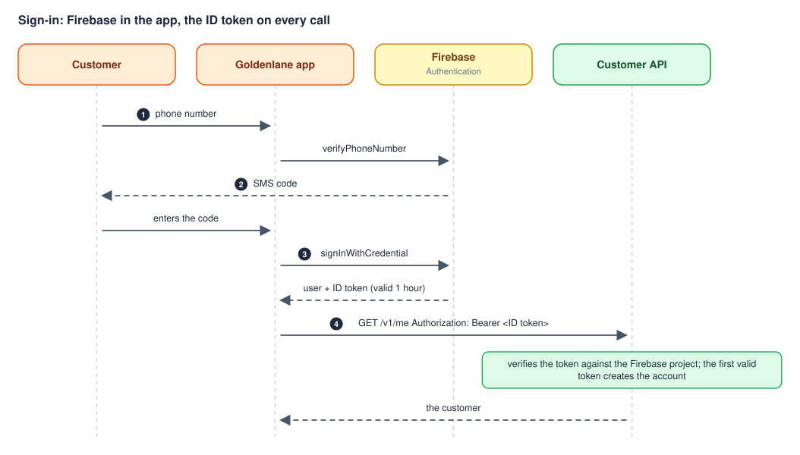
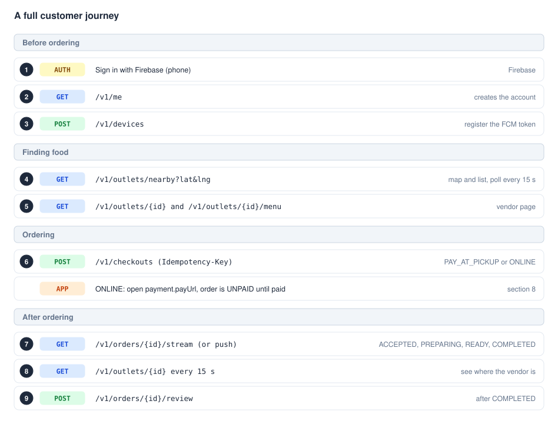

# Goldenlane customer app: API guide (Flutter)

This is the guide for the developers of the **Goldenlane** customer app. The app lets a customer
find street food vendors near them, follow a mobile vendor on a map, order, pay, and watch the order
progress. The vendors use **Ansilum** (the POS); the app never talks to the POS.

The exact contract of every endpoint is in [`api/openapi.yaml`](../api/openapi.yaml). This document
explains how the pieces fit together and what to build.

## Contents

1. [Quick facts](#1-quick-facts)
2. [What the Flutter project needs](#2-what-the-flutter-project-needs)
3. [Conventions](#3-conventions-every-endpoint-follows)
4. [Sign-in](#4-sign-in)
5. [Find vendors and follow them on the map](#5-find-vendors-and-follow-them-on-the-map)
6. [Menu](#6-menu)
7. [Place an order](#7-place-an-order)
8. [Pay online](#8-pay-online)
9. [Follow an order](#9-follow-an-order)
10. [Reviews](#10-reviews)
11. [Account and push notifications](#11-account-and-push-notifications)
12. [Error codes](#12-error-codes)
13. [A full customer journey](#13-a-full-customer-journey)
14. [Server settings the app depends on](#14-server-settings-the-app-depends-on)
15. [Troubleshooting](#15-troubleshooting)

---

## 1. Quick facts

| | |
|---|---|
| Staging base URL | `https://staging-goldlane.calterras.com` (note the spelling, it answers `/healthz` with 200) |
| API prefix | `/v1` |
| Format | JSON over HTTPS, UTF-8 |
| Sign-in | Firebase Authentication in the app; the Firebase **ID token** goes in `Authorization: Bearer <token>` |
| Public (no sign-in) | `GET /v1/outlets/nearby`, `GET /v1/outlets/{id}`, `GET /v1/outlets/{id}/menu`, `GET /v1/outlets/{id}/reviews` |
| Money | integer **minor units**: Rp 5.000 is `500000` (divide by 100 to show rupiah) |
| Times | UTC, RFC 3339 (`2026-11-21T07:10:02Z`) |
| Live updates | orders: server-sent events or push; vendor positions: **polling** |

The Ansilum POS at `https://api.ansilum.com/app/terrapos` is **not** called by the app. The customer
API talks to it. Never put POS addresses or keys in the app.

---

## 2. What the Flutter project needs

### Packages

| Need | Package (suggestion) |
|---|---|
| Firebase core and sign-in | `firebase_core`, `firebase_auth` |
| Push notifications | `firebase_messaging` (+ `flutter_local_notifications` to show them in the foreground) |
| HTTP | `dio` (interceptors, streaming) or `http` |
| JSON models | `json_serializable` or `freezed` |
| Map | `google_maps_flutter` or `flutter_map` (OpenStreetMap) |
| User location | `geolocator` |
| Open the payment page | `url_launcher`, or `flutter_inappwebview` / `webview_flutter` |
| Deep links back from payment | `app_links` |
| Unique keys | `uuid` |
| Secure local storage (optional) | `flutter_secure_storage`. You do not need to store the ID token: ask Firebase for it each time |

### Firebase setup (must match the server)

The server accepts only ID tokens issued by **its** Firebase project (`FIREBASE_PROJECT_ID`, currently
`posterra-cceaa` in your notes; confirm with the backend owner). The Flutter app must use the same
project, otherwise every call returns `401 UNAUTHORIZED`.

1. Add the Android app (package name) and iOS app (bundle ID) to that Firebase project.
2. Run `flutterfire configure` to generate `firebase_options.dart`, or add `google-services.json`
   (Android) and `GoogleService-Info.plist` (iOS). The `project_id` inside them must equal the server's.
3. Enable the sign-in method(s) under Authentication, Sign-in method. The server accepts any Firebase
   provider; a phone number is stored when the token has one. Phone (OTP) is the intended primary method.
4. **Android phone sign-in:** add your debug and release **SHA-1 and SHA-256** fingerprints in
   Project settings (`./gradlew signingReport`). Without them OTP fails with `app-not-authorized` or
   Play Integrity errors.
5. **iOS phone sign-in and push:** upload an APNs authentication key in Cloud Messaging, enable the
   Push Notifications and Background Modes (remote notifications) capabilities, and add the reCAPTCHA
   URL scheme (the `REVERSED_CLIENT_ID`) to `Info.plist`.
6. For testing, add fixed test phone numbers with their codes under Authentication, Phone.
7. Push token: the app sends the FCM token to the server (section 11). The server can only deliver
   if it has the Firebase service account configured (`FCM_SERVICE_ACCOUNT_FILE`, section 14).

### Platform settings

- **Android**: `INTERNET`, `ACCESS_FINE_LOCATION` / `ACCESS_COARSE_LOCATION`, and `POST_NOTIFICATIONS`
  (Android 13+) in `AndroidManifest.xml`. HTTPS only, no cleartext traffic is needed for staging.
- **iOS**: `NSLocationWhenInUseUsageDescription` in `Info.plist`, push capability, and your URL scheme
  or associated domain for the payment return link.
- **Deep link for payment return**: pick one address, for example `goldenlane://payment-result`, register
  it in both platforms, and give the same value to the backend owner as `PAYMENT_RETURN_URL`.

### One place for the base URL

```dart
// lib/config.dart
const apiBase = String.fromEnvironment(
  'API_BASE',
  defaultValue: 'https://staging-goldlane.calterras.com',
);
// production build: flutter build apk --dart-define=API_BASE=https://<production host>
```

---

## 3. Conventions every endpoint follows

### The envelope

Every JSON answer has the same shape:

```json
{ "status": true,  "message": "ok",  "data": { ... } }
{ "status": false, "message": "sign in required", "code": "UNAUTHORIZED", "data": null }
```

- Branch on the **HTTP status** first, then on `code` for errors. `message` is for logs, not for the
  customer; show your own translated text for each `code`.
- Success with no body: `204 No Content` (no JSON).
- `data` on errors can carry detail, for example `{"totalMinor": 1250000}` for `PRICE_CHANGED`.

### Identifiers and timestamps

IDs are UUID strings (outlets, orders, customers). Product, variant and option IDs inside a menu are
strings issued by the POS: send them back exactly as received. Parse timestamps as UTC.

### Headers

| Header | When |
|---|---|
| `Authorization: Bearer <Firebase ID token>` | every endpoint that is not public |
| `Content-Type: application/json` | requests with a body |
| `Idempotency-Key: <uuid v4>` | `POST /v1/checkouts` (required) |

There is no API key and no version header.

### Caching

Search, outlet and order responses are sent with `Cache-Control: no-store`. The menu allows 15 seconds.
Do not add your own long caches for positions or order status.

### Limits and timeouts

- Per customer: at most **5 open orders** and **20 checkouts per hour** (`429 TOO_MANY_ORDERS`).
- A checkout waits for the merchant's POS, so give that call a longer timeout (20 to 30 seconds).
- The server ends an order stream every 10 minutes by design; reconnect (section 9).

---

## 4. Sign-in

The API never sees passwords or SMS codes. The app signs in with Firebase, then sends the resulting ID
token on every request. **The first valid token creates the customer account**, so there is no
register call.



### Dart

```dart
// 1. Sign in (phone example)
await FirebaseAuth.instance.verifyPhoneNumber(
  phoneNumber: '+628123456789',
  verificationCompleted: (cred) => FirebaseAuth.instance.signInWithCredential(cred),
  verificationFailed: (e) => /* show e.code */ null,
  codeSent: (verificationId, _) => /* ask the customer for the code */ null,
  codeAutoRetrievalTimeout: (_) {},
);
// then: signInWithCredential(PhoneAuthProvider.credential(verificationId: id, smsCode: code))

// 2. Attach a fresh token to every call. Firebase caches it and refreshes it when it is close to expiry.
class AuthInterceptor extends Interceptor {
  @override
  Future<void> onRequest(RequestOptions options, RequestInterceptorHandler h) async {
    final user = FirebaseAuth.instance.currentUser;
    if (user != null) {
      final token = await user.getIdToken(); // pass true to force a refresh
      options.headers['Authorization'] = 'Bearer $token';
    }
    h.next(options);
  }

  @override
  Future<void> onError(DioException e, ErrorInterceptorHandler h) async {
    // One retry with a forced refresh on 401, then send the customer to the sign-in screen.
    if (e.response?.statusCode == 401 && e.requestOptions.extra['retried'] != true) {
      final user = FirebaseAuth.instance.currentUser;
      final token = await user?.getIdToken(true);
      if (token != null) {
        final req = e.requestOptions
          ..headers['Authorization'] = 'Bearer $token'
          ..extra['retried'] = true;
        return h.resolve(await dio.fetch(req));
      }
    }
    h.next(e);
  }
}
```

### After sign-in

Call `GET /v1/me`. It returns the customer and proves the token is accepted.

```json
{ "status": true, "message": "ok", "data": {
  "id": "5b1e…", "phone": "+628123456789", "name": "Rina", "avatarUrl": null,
  "status": "active", "createdAt": "2026-11-21T07:10:02Z" } }
```

| Result | Meaning | What the app does |
|---|---|---|
| `200` | signed in | continue |
| `401 UNAUTHORIZED` | no token, expired, wrong Firebase project | refresh the token once; if it still fails, sign out |
| `403 ACCOUNT_UNAVAILABLE` | account suspended or deleted | show a message, sign out |

Tokens last one hour; `getIdToken()` handles renewal. A stream (section 9) is re-authenticated each
time it reconnects.

---

## 5. Find vendors and follow them on the map

### `GET /v1/outlets/nearby` (public)

| Query | Required | Meaning |
|---|---|---|
| `lat`, `lng` | yes | the customer's position (or the map center) |
| `radius_m` | no | search radius in meters. Default `2000`, maximum `50000` |
| `open_now` | no | `true` returns only outlets open now |
| `q` | no | text search over outlet, merchant and dish names (max 80 characters) |
| `limit` | no | default `20`, maximum `50` |

```json
{ "status": true, "message": "ok", "data": { "outlets": [
  { "id": "0b4c…", "name": "Bakso Pak Slamet", "merchant": "Warung Sri",
    "address": null, "phone": "+62812…",
    "locationMode": "MOBILE",
    "location": { "mode": "LIVE", "latitude": -6.2010, "longitude": 106.8001,
                  "accuracyM": 8, "headingDeg": 90, "moving": true,
                  "recordedAt": "2026-11-21T07:10:02Z", "stale": false },
    "distanceMeters": 340,
    "isOpenNow": true, "acceptingOrders": true, "acceptsOnlinePayment": true,
    "prepTimeMinutes": 10, "timezone": "Asia/Jakarta",
    "hours": [ { "dayOfWeek": 1, "opensAt": "08:00", "closesAt": "17:00" } ],
    "today": { "startedAt": "2026-11-21T01:00:00Z", "spotName": "Depan Stasiun" },
    "rating": { "average": 4.6, "count": 18 } } ] } }
```

Nearest first. `distanceMeters` appears only in search results. `rating` is `null` until the first review.
Optional fields are omitted or `null`: always handle both.

### `GET /v1/outlets/{id}` (public)

The same object for one outlet (no `distanceMeters`). Use it to refresh a single vendor.

### Fixed shops and moving vendors

| Field | Value | Meaning |
|---|---|---|
| `locationMode` | `FIXED` | a shop or kiosk at an address |
| | `MOBILE` | a cart or truck that moves |
| `location.mode` | `FIXED` | the address position |
| | `LIVE` | the vendor's GPS, updating |
| | `SPOT` | the place the vendor chose for today, **not** its GPS (never stale, never moving) |

A mobile vendor appears **only while its working day is open** and it shares a position. Otherwise it
is not in the results at all. `isOpenNow` and `acceptingOrders` are computed by the server; trust them.

### Following a vendor in real time

There is no position stream. **Poll**, and treat the server as the clock:

- On the map screen, call `nearby` every **15 seconds** with the visible map center and radius.
  Positions are published by the POS at most every 15 seconds and only after the cart moved about
  20 meters, so polling faster gains nothing.
- On a vendor's detail or order-tracking screen, call `GET /v1/outlets/{id}` every 15 seconds.
- Pause polling when the app is in the background or the screen is closed.
- Animate the marker from the old position to the new one rather than jumping.
- Use `moving` and `headingDeg` (when present) for a direction arrow.

How fresh a `LIVE` position is, judged by the server on every request:

| Age of the position | What you get | What to show |
|---|---|---|
| up to 3 minutes | `stale: false` | a live dot |
| 3 to 10 minutes | `stale: true` | a grayed dot with "last seen" and time from `recordedAt` |
| over 10 minutes | the vendor is **left out** of results | remove the marker |

Fixed places and `SPOT` positions never go stale. When a vendor you were following disappears from
the answer, show "this vendor is offline".

```dart
Timer.periodic(const Duration(seconds: 15), (_) async {
  if (!mounted || !appInForeground) return;
  final r = await dio.get('/v1/outlets/nearby', queryParameters: {
    'lat': center.latitude, 'lng': center.longitude, 'radius_m': 2000, 'open_now': true,
  });
  setState(() => outlets = (r.data['data']['outlets'] as List).map(Outlet.fromJson).toList());
});
```

### Search by name or dish

`q=bakso` returns outlets whose name, merchant or menu items match, still nearest first within the
radius. Debounce typing by about 400 ms.

---

## 6. Menu

### `GET /v1/outlets/{id}/menu` (public)

```json
{ "status": true, "message": "ok", "data": {
  "catalogVersion": 12, "fetchedAt": "2026-11-21T06:55:00Z",
  "menu": {
    "catalogVersion": 12,
    "pricing": { "taxRate": 0.11, "serviceChargeRate": 0 },
    "categories": [ { "id": "c1", "name": "Bakso", "products": [
      { "id": "p1", "name": "Bakso Urat", "description": "…", "imageUrl": "https://…",
        "priceMinor": 1500000, "soldOut": false,
        "variants": [ { "id": "v1", "name": "Jumbo", "available": true } ],
        "modifierGroups": [ { "id": "g1", "name": "Level pedas", "minSelection": 0, "maxSelection": 1,
                              "options": [ { "id": "o1", "name": "Pedas", "available": true } ] } ] } ] } ] } } }
```

- The menu is exactly what the vendor's POS publishes. The POS owns prices and availability.
- Prices are in minor units. Variants and options carry whatever price fields the POS publishes; read
  a real response from a registered outlet before you fix your model, and keep unknown fields tolerated.
- Grey out `soldOut: true` products and `available: false` variants or options.
- A modifier group needs between `minSelection` and `maxSelection` chosen options. Enforce that in the
  UI. The server checks it too and answers `ORDER_INVALID` with the details.
- The display total you compute (item prices, `taxRate`, `serviceChargeRate`) is **an estimate**. The
  POS prices the order and its answer is the real total (section 7).
- Reload the menu when the customer opens an outlet and again before checkout.

---

## 7. Place an order

### `POST /v1/checkouts` (signed in)

```http
POST /v1/checkouts
Authorization: Bearer <token>
Idempotency-Key: 3f1a9c5e-7d62-4b0e-9a7e-0f1c2d3e4a5b
Content-Type: application/json

{
  "outletId": "0b4c…",
  "fulfillment": { "type": "PICKUP", "label": null },
  "notes": "Tanpa seledri",
  "expectedTotalMinor": 3330000,
  "payment": { "mode": "PAY_AT_PICKUP" },
  "items": [
    { "productId": "p1", "variantId": "v1", "modifierIds": ["o1"], "quantity": 2, "notes": null }
  ]
}
```

| Field | Notes |
|---|---|
| `outletId` | required |
| `items` | required, at least one. `productId` and `quantity` (≥ 1) required; `variantId`, `modifierIds`, `notes` optional. At most 30 lines and 50 items |
| `fulfillment.type` | `PICKUP` (default) or `DINE_IN`; `label` is free text such as a table number |
| `payment.mode` | `PAY_AT_PICKUP` (default) or `ONLINE`. Offer `ONLINE` only when the outlet says `acceptsOnlinePayment: true` |
| `expectedTotalMinor` | optional but recommended: the total the customer saw. If the real price differs, the order is refused with `PRICE_CHANGED` |
| `Idempotency-Key` | **required**. Generate a new UUID per checkout *attempt* and reuse it only when retrying the same attempt (timeout, no answer) |

Behaviour of the key: repeating a key with the same order returns the same order (`200` instead of
`201`) and never creates a second one; using a key for a *different* order is `409 IDEMPOTENCY_CONFLICT`.
So: create the UUID when the customer taps **Order**, keep it until you get an answer, and create a
new one for a new attempt after an error that changed the cart.

### Success

`201 Created` (or `200` for a repeated key):

```json
{ "status": true, "message": "created", "data": { "order": { /* order object, section 9 */ } } }
```

For pay at pickup the order is `CREATED` and reaches the POS within seconds; the answer usually
already shows `PENDING_ACCEPTANCE` with the POS's `pricing`. For `ONLINE` the order is `UNPAID` with
`payment.payUrl` (section 8).

### Errors to handle

| HTTP | `code` | Meaning | App action |
|---|---|---|---|
| 409 | `PRICE_CHANGED` | the real total differs. `data.totalMinor` is the new total | show the new total, ask to confirm, then retry with a **new** key and the new `expectedTotalMinor` |
| 409 | `OUTLET_CLOSED` | the outlet is not taking orders | tell the customer; refresh the outlet |
| 409 | `OUTLET_UNAVAILABLE` | the outlet is not available | same |
| 409 | `IDEMPOTENCY_CONFLICT` | key reused for another order | generate a new key |
| 422 | `ORDER_INVALID` | `data.problems` lists lines that cannot be ordered | highlight those lines; reload the menu |
| 422 | `ONLINE_PAYMENT_UNAVAILABLE` | merchant has no online payment | switch to pay at pickup |
| 422 | other POS reason code | the POS refused the order; `data.order` is included | show the order's `error`/`reason` |
| 429 | `TOO_MANY_ORDERS` | 5 open orders or 20 checkouts per hour | ask to wait or finish current orders |
| 503 | `MERCHANT_UNREACHABLE` | cannot reach the merchant to price an online order | offer a retry later |
| 401 | `UNAUTHORIZED` | not signed in | section 4 |

`ORDER_INVALID` problems look like:

```json
{ "line": 0, "code": "OPTION_SELECTION", "group": "Level pedas", "min": 1, "max": 1 }
```

`line` is the zero-based index in your `items`. Codes: `PRODUCT_UNAVAILABLE`, `VARIANT_UNAVAILABLE`,
`OPTION_UNAVAILABLE`, `OPTION_SELECTION` (wrong number of options in `group`, expected `min` to `max`).

A **timeout without an answer** is not a failure: retry with the **same** key. You get either the same
order or a clear error.

---

## 8. Pay online

Used when `payment.mode` is `ONLINE`. The customer pays on the merchant's own Xendit or Midtrans page;
this API and the app never touch card data or hold the money.

1. Checkout with `"payment": {"mode": "ONLINE"}`. The order is `UNPAID`.
2. Read `order.payment`:

```json
"payment": {
  "status": "PENDING", "provider": "XENDIT", "attempt": 1,
  "orderTotalMinor": 3330000, "customerFeeMinor": 84000, "amountMinor": 3414000,
  "payUrl": "https://checkout.xendit.co/web/…", "expiresAt": "2026-11-21T07:25:02Z",
  "paidAt": null, "method": null, "error": null, "refund": null },
"canPay": true, "paymentDeadline": "2026-11-21T07:25:02Z"
```

3. Show the customer what they will pay: `amountMinor` (the order total plus the platform's
   `customerFeeMinor`). Label the fee clearly.
4. Open `payUrl` in the system browser (`url_launcher`, `LaunchMode.externalApplication`) or an in-app
   web view. The customer pays there.
5. When the customer returns (deep link from `PAYMENT_RETURN_URL`, or they just come back), fetch
   `GET /v1/orders/{id}` or keep the order stream open. Do not decide "paid" from the deep link alone:
   **the order status is the truth.**
6. Paid: the order moves `UNPAID` to `CREATED`, then on to the merchant as in section 9.

| Order/payment | Meaning | Show |
|---|---|---|
| `UNPAID`, `canPay: true`, `payment.status: PENDING` | waiting for payment | "Pay now" opening `payUrl`, with a countdown to `paymentDeadline` (15 minutes) |
| `UNPAID`, `canPay: true`, `payment.status` `FAILED`/`EXPIRED`/`CANCELLED` | attempt failed or abandoned | "Try again" calling `POST /v1/orders/{id}/payment` |
| `EXPIRED` with `error.code: PAYMENT_EXPIRED` | not paid in time | "Order again" |
| `payment.refund.status: PENDING` / `DONE` | money is being returned automatically | "Refund on its way" / "Refunded" |
| `payment.refund.status: FAILED` | the gateway could not refund | "The merchant will return the money by hand" |

### `POST /v1/orders/{id}/payment` (signed in)

Retry. Opens a new payment attempt, or returns the one still open. Returns the order with the current
`payment.payUrl`. Possible errors: `409 NOT_PAYABLE` (already paid, closed, or past the deadline),
`422 ONLINE_PAYMENT_UNAVAILABLE`.

A finished attempt has `payUrl: null`. `canPay` is the single flag for showing the pay button.

If the customer never returns to the app, the server finds the payment on its own within about half a
minute and the push notification or next poll shows the new status.

---

## 9. Follow an order

### The order object

Returned by checkout, `GET /v1/orders/{id}`, the list, cancel, retry-payment and the stream:

```json
{
  "id": "e1c0…", "status": "PREPARING", "open": true, "canCancel": false,
  "outlet": { "id": "0b4c…", "name": "Bakso Pak Slamet" },
  "fulfillment": { "type": "PICKUP", "label": null },
  "notes": "Tanpa seledri",
  "items": [ { "lineNo": 1, "productId": "p1", "variantId": "v1", "modifierIds": ["o1"],
               "quantity": 2, "notes": null, "name": "Bakso Urat", "variantName": "Jumbo" } ],
  "pricing": { "subtotalMinor": 3000000, "taxMinor": 330000, "serviceMinor": 0, "totalMinor": 3330000 },
  "paymentMode": "PAY_AT_PICKUP", "payment": null, "paymentDeadline": null, "canPay": false,
  "acceptBy": "2026-11-21T07:15:00Z", "prepTimeMinutes": 10, "reason": null, "error": null,
  "createdAt": "…", "updatedAt": "…", "completedAt": null
}
```

`pricing` is `null` until the POS has priced the order. `open` says whether more news is expected.
`canCancel` is the flag for the cancel button.

### Statuses

| `status` | Meaning | Customer sees |
|---|---|---|
| `UNPAID` | waiting for online payment | pay button, countdown |
| `CREATED` | stored, being sent to the merchant | "Sending…" |
| `PENDING_ACCEPTANCE` | the merchant has it, has not answered | "Waiting for the merchant" until `acceptBy` |
| `ACCEPTED` | accepted, `prepTimeMinutes` is the estimate | "Accepted, about N minutes" |
| `PREPARING` | being made | "Preparing" |
| `READY` | ready for pickup | "Ready, come pick it up" |
| `COMPLETED` | done (`completedAt`) | enable the review |
| `REJECTED` | the merchant refused (`reason` may say why) | show the reason |
| `CANCELLED` | cancelled (`reason`) | |
| `EXPIRED` | the merchant did not answer in time, or payment time ran out (`error.code` `PAYMENT_EXPIRED`) | offer to order again |
| `SUBMIT_FAILED` | the POS refused it or could not be reached; see `error.code` (for example `MERCHANT_UNREACHABLE`) | offer to try again |

Open statuses (`open: true`): `UNPAID`, `CREATED`, `PENDING_ACCEPTANCE`, `ACCEPTED`, `PREPARING`, `READY`.
Everything else is final.

### Read and list

- `GET /v1/orders/{id}`: one order. `404 NOT_FOUND` also when it belongs to someone else.
- `GET /v1/orders?limit=20&before=<RFC 3339>`: your orders, newest first, in `data.orders`. For the next
  page pass the `createdAt` of the **last** order you received as `before`. Escape the `+` of a time zone
  offset (`%2B`) or use UTC (`Z`). An empty array means the end.

### Cancel: `POST /v1/orders/{id}/cancel`

Allowed while `canCancel` is true (`UNPAID`, `CREATED`, `PENDING_ACCEPTANCE`). Repeating is harmless.
After the merchant accepted: `409 CANNOT_CANCEL` ("ask the merchant"). A paid online order that is
cancelled or refused is refunded automatically.

### Live updates

Use **two** channels together:

1. **The order stream (SSE)** while the order screen is open.
2. **Push notifications** when the app is closed (section 11).

`GET /v1/orders/{id}/stream` with `Authorization: Bearer <token>` and `Accept: text/event-stream`.

```
event: order
data: {"id":"e1c0…","status":"ACCEPTED", ...the full order object... }

: ping

event: reconnect
data: {}
```

- The first event arrives at once with the current state; then one per change. Each carries the full
  order, so the app only replaces its copy.
- `: ping` comments arrive every 15 seconds to keep the connection open; ignore them.
- After 10 minutes the server sends `event: reconnect` and closes. Reconnect immediately (with a fresh
  token). Also reconnect after any network error, with a backoff (1, 2, 4, 8 seconds up to 30).
- Browsers' built-in `EventSource` cannot send an `Authorization` header. In Flutter use `dio` with
  `ResponseType.stream` (below) or a client that supports headers (for example `flutter_client_sse`).
- If streaming is not possible, fall back to polling `GET /v1/orders/{id}` every 5 to 10 seconds while the
  order is `open`, and stop when it is not.

```dart
Stream<Order> watchOrder(String id) async* {
  while (true) {
    try {
      final token = await FirebaseAuth.instance.currentUser!.getIdToken();
      final res = await dio.get<ResponseBody>('/v1/orders/$id/stream',
          options: Options(responseType: ResponseType.stream, headers: {
            'Authorization': 'Bearer $token', 'Accept': 'text/event-stream'}));
      String event = 'message';
      await for (final line in res.data!.stream
          .cast<List<int>>().transform(utf8.decoder).transform(const LineSplitter())) {
        if (line.startsWith('event:')) event = line.substring(6).trim();
        else if (line.startsWith('data:') && event == 'order') {
          yield Order.fromJson(jsonDecode(line.substring(5)));
        } else if (line.isEmpty) event = 'message';
        if (line.startsWith('event:') && line.contains('reconnect')) break;
      }
    } catch (_) { await Future.delayed(const Duration(seconds: 3)); }
    // loop: reconnect
  }
}
```

(Stop the loop when the order is no longer `open` or the screen is disposed.)

### Tracking the vendor while the order is open

On the order screen, show the vendor on a map using `GET /v1/outlets/{order.outlet.id}`, polled every
15 seconds as in section 5, and the distance from the customer's own position. For a mobile vendor
whose `location.stale` is true, show "last seen" instead of a live dot.

---

## 10. Reviews

- `POST /v1/orders/{id}/review` with `{ "rating": 1..5, "comment": "optional" }`. Only for a `COMPLETED`
  order, once. `201` returns the review; `409 ALREADY_REVIEWED` if done. The outlet's `rating` updates.
- `GET /v1/outlets/{id}/reviews?limit=20&before=<RFC 3339>` (public): `data.reviews`, newest first, each
  `{ id, rating, comment, reviewer, createdAt }`. Page with the last `createdAt` as `before`.

---

## 11. Account and push notifications

| Call | Purpose |
|---|---|
| `GET /v1/me` | the customer |
| `PATCH /v1/me` | `{ "name": "…" }` (1 to 80 characters) and/or `{ "avatarUrl": "https://…" }` (https only). The phone number comes from sign-in and cannot be edited |
| `DELETE /v1/me` | close the account and erase personal data. `204`. Ask the customer to confirm; it cannot be undone. Then sign out of Firebase |
| `POST /v1/devices` | register the push token: `{ "platform": "android" | "ios" | "web", "token": "<FCM token>" }`, `204` |

### Push

1. Ask for notification permission (`FirebaseMessaging.instance.requestPermission()`).
2. After sign-in, `getToken()` and send it to `POST /v1/devices`. Do it again whenever
   `onTokenRefresh` fires and after every sign-in (a token belongs to the latest account that registered it).
3. The server sends pushes for these statuses only: `ACCEPTED`, `READY`, `REJECTED`, `CANCELLED`, and
   `EXPIRED`. Text is in Indonesian. The payload `data` is
   `{ "type": "order", "orderId": "<uuid>", "status": "READY" }`. On tap, open that order and fetch it.
4. A push is a hint. When it arrives, call `GET /v1/orders/{orderId}` for the truth.

Push works only if the server has `FCM_SERVICE_ACCOUNT_FILE` configured (section 14). Without it, orders
and streams still work and push is skipped silently.

---

## 12. Error codes

| HTTP | `code` | Where | Meaning |
|---|---|---|---|
| 400 | `BAD_REQUEST` | any | invalid input; `message` says what (bad coordinate, bad JSON, bad `before`) |
| 401 | `UNAUTHORIZED` | signed-in endpoints | missing, expired or wrong-project token |
| 403 | `ACCOUNT_UNAVAILABLE` | signed-in endpoints | account suspended or deleted |
| 404 | `NOT_FOUND` | outlets, orders | unknown, not listed, or not yours. A malformed outlet id is also 404 |
| 409 | `CONFLICT` | any | already exists |
| 409 | `NOT_PAYABLE` | pay | order paid, closed or past its deadline |
| 409 | `CANNOT_CANCEL` | cancel | the merchant already accepted |
| 409 | `ALREADY_REVIEWED` | review | |
| 409 | `PRICE_CHANGED` | checkout | `data.totalMinor` is the new total |
| 409 | `OUTLET_CLOSED`, `OUTLET_UNAVAILABLE` | checkout | |
| 409 | `IDEMPOTENCY_CONFLICT` | checkout | key reused for a different order |
| 422 | `ORDER_INVALID` | checkout | `data.problems` |
| 422 | `ONLINE_PAYMENT_UNAVAILABLE` | checkout, pay | |
| 429 | `TOO_MANY_ORDERS` | checkout | |
| 500 | none | any | server error; retry later, do not repeat a checkout with a new key |
| 503 | `MERCHANT_UNREACHABLE` | checkout | |

Unknown codes: show a generic message and log `code` and `message`. Network errors and timeouts are
not API errors: retry reads, and retry a checkout **with the same key**.

---

## 13. A full customer journey



---

## 14. Server settings the app depends on

These are set by whoever deploys the API (see the README, "Deploying"). Check them against the app:

| Server setting | What it must be for the app to work |
|---|---|
| `FIREBASE_PROJECT_ID` | the **same Firebase project** as the app's `google-services.json`, `GoogleService-Info.plist` or `firebase_options.dart`. Otherwise every call is `401` |
| `HTTP_CORS_ALLOW_ORIGINS` | **not needed for Android or iOS apps** (CORS is a browser rule). Required only for Flutter **web**: add the web app's `https` origin. Outside development every origin must be `https` |
| `PUBLIC_BASE_URL` | the public address of this API: `https://staging-goldlane.calterras.com` |
| `PAYMENT_RETURN_URL` | the app's deep link, for example `goldenlane://payment-result`, which the gateway opens after payment. Must match what is registered in the app |
| `FCM_SERVICE_ACCOUNT_FILE` | a Firebase service account key of the **same project**, or push is off |
| `POS_ALLOWED_HOSTS` | `api.ansilum.com`. Not used by the app, but a vendor can only be registered if this matches; with no registered vendor, `nearby` returns an empty list |
| `APP_ENV` | `staging` or `production`; both require `https` |

Merchants appear only after the operator registers them (`POST /v1/admin/merchants`) with the key
created in their POS, with `posBaseUrl` set to `https://api.ansilum.com` (no path). Until then the app
shows an empty map.

---

## 15. Troubleshooting

| Symptom | Likely cause |
|---|---|
| Every signed-in call returns `401 UNAUTHORIZED` | The app's Firebase project differs from `FIREBASE_PROJECT_ID`, or you send the wrong token (send the **ID token** from `getIdToken()`, not the FCM token or a refresh token) |
| `nearby` returns `{"outlets":[]}` | No merchant is registered, no outlet is published, the vendor has not opened its day, the vendor's position is older than 10 minutes, or the radius is too small |
| Phone OTP fails on Android | Missing SHA-1/SHA-256 in Firebase, or no Play Services. Use a test phone number to check |
| No push notifications | No `POST /v1/devices` after sign-in, notification permission denied, APNs key missing on iOS, or the server has no `FCM_SERVICE_ACCOUNT_FILE` |
| Checkout hangs and then `503 MERCHANT_UNREACHABLE` | The POS did not answer in time (online orders), or for pay-at-pickup the order ended `MERCHANT_UNREACHABLE` after about 2 minutes. Retry later |
| `PRICE_CHANGED` on every attempt | You keep sending the old `expectedTotalMinor`; use `data.totalMinor` |
| The stream drops every few minutes | Expected: reconnect on `event: reconnect` and on errors |
| Flutter **web** checkout fails in the browser while mobile works | Browser CORS: the origin is not in `HTTP_CORS_ALLOW_ORIGINS`, and the server's CORS rule lists only `Authorization` and `Content-Type` as allowed headers, not `Idempotency-Key` (backend change needed) |
