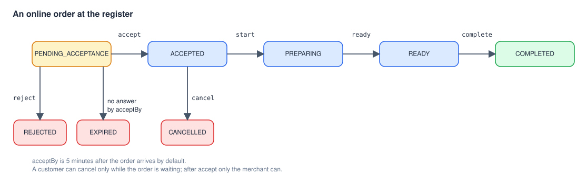
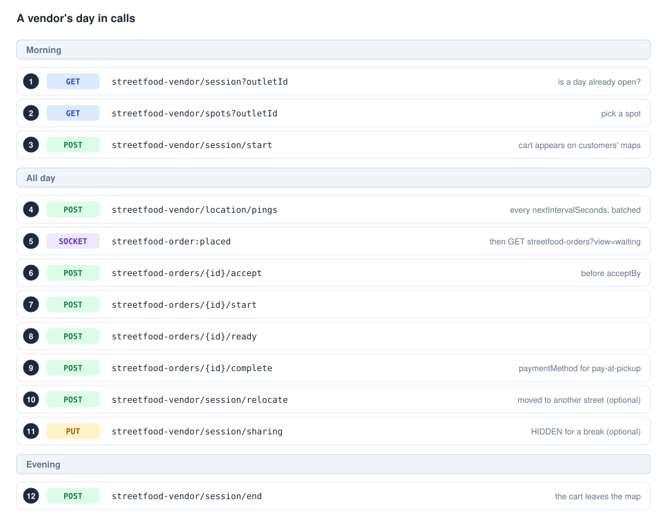

# Ansilum vendor / POS app: StreetFood API guide

This is the guide for the developers of the **Ansilum** app used by the people who **sell**: the
vendor pushing a cart or driving a truck, the cashier at a kiosk, and the business owner who sets
the outlet up. These screens talk to the **POS backend** (`ansilum-be`), **not** to the customer API.

Customers use a different app and a different backend: see [`MOBILE_API_CUSTOMER.md`](MOBILE_API_CUSTOMER.md).
The side-by-side comparison is in [`MOBILE_API.md`](MOBILE_API.md), and the story of how both meet is in
[`USER_JOURNEY.md`](USER_JOURNEY.md).

> Source of this document: the controllers and DTOs of `ansilum-be`
> (`src/domain/streetfood/*`). The POS's own Swagger is the exact contract; where this guide says
> "not documented here", check it.

## Contents

1. [Quick facts](#1-quick-facts)
2. [Turning the feature on](#2-turning-the-feature-on)
3. [Conventions](#3-conventions)
4. [Owner setup](#4-owner-setup-roles-owner-and-admin)
5. [The vendor's working day](#5-the-vendors-working-day)
6. [Broadcasting the position](#6-broadcasting-the-position-gps)
7. [Online orders at the register](#7-online-orders-at-the-register)
8. [Real-time events](#8-real-time-events)
9. [Reports for the owner](#9-reports-for-the-owner)
10. [Endpoints this app must never call](#10-endpoints-this-app-must-never-call)
11. [A vendor's day in calls](#11-a-vendors-day-in-calls)
12. [Troubleshooting](#12-troubleshooting)

---

## 1. Quick facts

| | |
|---|---|
| POS API base URL | `https://api.ansilum.com/app/terrapos` |
| Owner dashboard (web) | `https://dashboard.ansilum.com/street-food` |
| Sign-in | the normal Ansilum session: `Authorization: Bearer <JWT>` |
| Tenant | header `x-tenant-id: <business id>` on every call below |
| Scope of each call | `outletId` (required) and `deviceId` (optional, the provisioned POS device) |
| Roles | **owner / admin** set up the link, publication, hours, spots and reports. **Any staff member with access to the outlet** runs the day and the orders |
| Realtime | the POS's socket for orders and the day, plus the app's own GPS loop |
| Customer data | never fetched from the customer API. Orders arrive through the POS |

---

## 2. Turning the feature on

Every route in this guide answers **404 `STREETFOOD_DISABLED`** until the POS runs with:

```
STREETFOOD_ENABLED=true               # the feature
STREETFOOD_WORKERS_ENABLED=true       # sends events to the customer API, expires orders
STREETFOOD_ENCRYPTION_KEY=<openssl rand -base64 32>
STREETFOOD_ALLOWED_PLATFORM_HOSTS=<customer API host>    # for example staging-goldlane.calterras.com
```

If the app gets that 404 on a working POS, the flag is off for that environment.

---

## 3. Conventions

### Headers

```
Authorization: Bearer <JWT>
x-tenant-id: <business id>
Content-Type: application/json
```

### Which outlet and device

Every call names its outlet: as a query parameter on `GET`, in the JSON body on `POST`, `PUT` and `PATCH`
(and on `DELETE` as a query parameter).

| Field | Meaning |
|---|---|
| `outletId` | UUID of the outlet (required) |
| `deviceId` | UUID of the provisioned POS device making the call (optional). Use it when the app runs on a registered tablet or phone |

Orders and days of other businesses or outlets are "not found" for the caller.

### Errors

The POS's error body is not duplicated here. Treat HTTP status as the signal: `401` sign in again,
`403` the role is not allowed, `404` unknown thing or the feature is off, `400` invalid input (the
POS validates every field). Check the POS Swagger for the exact error shape.

---

## 4. Owner setup (roles OWNER and ADMIN)

Done once per business, from the dashboard `…/street-food`. Prefix: `integrations/streetfood`.

| Call | Purpose |
|---|---|
| `POST integrations/streetfood/link` `{ "platformUrl": "https://staging-goldlane.calterras.com" }` | Link the business to the customer platform. Returns a **key id** (`sfk_…`) and a **secret** (`sfs_…`). The secret is shown **once**: copy it and give it to the platform operator |
| `GET integrations/streetfood/overview` | The setup screen: link status, delivery health and every outlet |
| `GET integrations/streetfood/link` | Link status and published outlets |
| `POST integrations/streetfood/link/rotate-secret` | New secret; the old one stops working at once. The operator must update the platform, or order and position delivery stops |
| `DELETE integrations/streetfood/link` | Revoke the link and unpublish every outlet |
| `PUT integrations/streetfood/outlets/{outletId}/publication` `{ "enabled": true }` | Publish or hide an outlet for customers |
| `PUT integrations/streetfood/outlets/{outletId}/settings` | See below |
| `PUT integrations/streetfood/outlets/{outletId}/hours` | Replace the weekly hours |
| `GET integrations/streetfood/fees` | Platform fees owed, collected with the next subscription renewal |

### Outlet settings

```json
{
  "timezone": "Asia/Jakarta",
  "onlineStatus": "AUTO",
  "prepTimeMinutes": 10,
  "locationMode": "MOBILE",
  "locationSharing": "LIVE"
}
```

All fields are optional.

| Field | Values | Meaning |
|---|---|---|
| `onlineStatus` | `AUTO`, `OPEN`, `CLOSED`, `PAUSED` | `AUTO` follows the weekly hours. `OPEN` forces open and `CLOSED` forces closed. `PAUSED` is a temporary stop (confirm its exact behaviour in the POS Swagger) |
| `prepTimeMinutes` | 1 to 240 | the estimate customers see |
| `locationMode` | `FIXED`, `MOBILE` | a shop at an address, or a cart that moves |
| `locationSharing` | `LIVE`, `SPOT`, `HIDDEN` | the outlet's default of what customers see of its position |

### Weekly hours

```json
{ "intervals": [
  { "dayOfWeek": 1, "opensAt": "08:00", "closesAt": "17:00" },
  { "dayOfWeek": 1, "opensAt": "19:00", "closesAt": "02:00" }
] }
```

`dayOfWeek` is 0 (Sunday) to 6. Times are `HH:MM`, 24 hours. A `closesAt` earlier than `opensAt` means
after midnight. Up to 56 intervals; the call **replaces** all of them.

### Checklist for a new outlet

1. Link the business, copy the secret to the operator.
2. `settings`: `locationMode`, `prepTimeMinutes`, `timezone`, `onlineStatus`.
3. `hours` (if `AUTO`).
4. `publication` `enabled: true`.
5. Mobile outlets: create saved spots (section 5) and open the day.

---

## 5. The vendor's working day

A **mobile** outlet is not on the customers' map until its day is open. Prefix: `streetfood-vendor`.
Fixed outlets do not need a day.

| Call | Body / query | Purpose |
|---|---|---|
| `GET streetfood-vendor/session?outletId=…` | | Is the day open, where, and the latest position: `{ session, location }`, both `null` when no day is open. Call it when the app opens |
| `POST streetfood-vendor/session/start` | see below | Open the day at a saved spot or at the current position |
| `POST streetfood-vendor/session/relocate` | same as start | Move to another place: closes this day's session and opens the next |
| `PUT streetfood-vendor/session/sharing` | `{ outletId, sharing }` | Change what customers see now |
| `POST streetfood-vendor/session/end` | `{ outletId, notes? }` | Close the day |
| `GET streetfood-vendor/spots?outletId=…` | | Saved spots |
| `POST streetfood-vendor/spots` | `{ outletId, name, address?, latitude, longitude, radiusM? }` | Save a spot (**owner or admin**) |
| `PATCH streetfood-vendor/spots/{id}` | any of the above plus `isActive` | Edit a spot (**owner or admin**) |
| `DELETE streetfood-vendor/spots/{id}?outletId=…` | | Retire a spot (**owner or admin**); past reports keep its name |

### Start (and relocate)

```json
{
  "outletId": "0b4c…",
  "deviceId": "7d21…",
  "spotId": "9a3e…",
  "sharing": "LIVE",
  "notes": "Hujan, jualan sampai sore"
}
```

or, at the current position instead of a saved spot:

```json
{ "outletId": "0b4c…", "latitude": -6.2001, "longitude": 106.8001, "accuracyM": 12, "sharing": "LIVE" }
```

- A mobile outlet needs `spotId`, **or** `latitude` and `longitude`. A position inside a saved spot's
  radius is matched to that spot.
- `sharing` is `LIVE`, `SPOT` or `HIDDEN`. `accuracyM` is 0 to 2000. `notes` up to 300 characters.
- Only one day can be open per outlet. A day nobody closes is closed by the POS after 18 hours.

### Spots

`name` 1 to 80 characters, `address` up to 200, `radiusM` 10 to 5000 meters.

### What the answer looks like

```json
{ "session": {
  "id": "…", "outletId": "…", "active": true,
  "startedAt": "2026-11-21T01:00:00.000Z", "endedAt": null, "durationMinutes": 125,
  "spot": { "id": "…", "name": "Depan Stasiun" },
  "anchor": { "latitude": -6.2001, "longitude": 106.8001 },
  "sharing": "LIVE", "distanceMeters": 840, "pingCount": 57,
  "closeReason": null, "notes": null } }
```

`relocate` answers `{ previous, session }` (the closed day and the new one). `end` answers with the closed
session; read the POS Swagger for the exact wrapper.

### What each sharing choice means for the customer

| `sharing` | Customers see | GPS still sent to the POS? |
|---|---|---|
| `LIVE` | the moving dot | yes, and published |
| `SPOT` | the place of the day (never the GPS) | yes, for the owner's reports only |
| `HIDDEN` | nothing: the cart is not on the map | yes, for the owner's reports only |

Show the vendor clearly which one is active, with a one-tap switch. This is a privacy choice.

---

## 6. Broadcasting the position (GPS)

`POST streetfood-vendor/location/pings`. Needs an **open day**. This is the call the app makes in the
background all day.

```json
{
  "outletId": "0b4c…",
  "deviceId": "7d21…",
  "pings": [
    { "latitude": -6.2010, "longitude": 106.8001, "accuracyM": 8, "speedMps": 1.2,
      "headingDeg": 90, "recordedAt": "2026-11-21T07:10:02Z", "isMock": false }
  ]
}
```

| Field | Notes |
|---|---|
| `pings` | 1 to 100 readings per call, in any order |
| `latitude`, `longitude` | required numbers |
| `recordedAt` | required, ISO 8601 time of the **reading**, not of sending (up to 40 characters) |
| `accuracyM`, `speedMps`, `headingDeg` | optional; send them when the location plugin provides them |
| `isMock` | send `true` when the phone reports a mocked location (Android `isMock`/`isFromMockProvider`). Never hide it |

### The answer drives the app

```json
{ "accepted": 5, "duplicates": 0, "flagged": 1, "rejected": 0,
  "nextIntervalSeconds": 15, "sharing": "LIVE",
  "location": { "latitude": -6.2010, "longitude": 106.8001, "accuracyM": 8, "speedMps": 1.2,
                "headingDeg": 90, "moving": true, "recordedAt": "2026-11-21T07:10:02.000Z" } }
```

**Wait `nextIntervalSeconds` before the next call.** The POS sets it from whether the cart is moving
and what is shared:

| Sharing | Moving | Parked |
|---|---|---|
| `LIVE` | about 15 s | about 60 s |
| `SPOT` or `HIDDEN` | about 30 s | about 120 s |

### How the POS judges each reading

- **Rejected** (not stored): impossible coordinates, exactly 0,0, a time more than 5 minutes in the
  future or more than 24 hours old, accuracy worse than 2000 m or negative, impossible speed or heading.
- **Accepted but flagged**, kept for the owner's audit, **never shown to customers**: accuracy worse than
  100 m, mock location, a jump above 30 m/s, or not newer than the previous trusted reading.
- **Trusted**: everything else. The newest trusted reading becomes the current position.

One bad reading never spoils a batch.

### What the customer sees

The POS publishes the current position at most every **15 seconds** and only after the cart moved about
**20 m**; a parked cart is announced at least every 90 seconds. Customers therefore see a cart a few
seconds behind, which is expected.

### Client rules

1. **Foreground service / background location** on Android and the "Always" or "While using with
   background updates" mode on iOS, with the right permission strings. Show a visible notification that
   the location is being shared.
2. Collect readings continuously (for example every 5 to 10 s while moving), but **send** only every
   `nextIntervalSeconds`, as a batch.
3. **Queue offline.** Keep unsent readings on the device and send them when the network returns, up to
   100 per call. Readings older than 24 hours are rejected, so drop them.
4. Always send the true `recordedAt` of each reading, so late batches do not move the dot backwards.
5. Stop sending when the day ends. A call without an open day is refused.
6. Do not fake, smooth or snap positions in the app. The POS does the judging.
7. Respect the sharing choice in the UI, and make "Hide me" one tap.

---

## 7. Online orders at the register

Prefix: `streetfood-orders`. Orders placed by Goldenlane customers appear here, already priced by the POS.
Pay-online orders arrive **already paid** (marked prepaid).

| Call | Body / query | Purpose |
|---|---|---|
| `GET streetfood-orders?outletId=…&view=waiting` | `view`: `waiting` (default), `active`, `done` | The list, as `{ orders: [...] }` of summaries (`id`, `status`, `fulfillment`, `customerName`, `totalMinor`, `itemCount`, `paymentMode`, `acceptBy`, `createdAt`). `waiting` is new orders (oldest first), `active` is accepted to ready, `done` is finished orders of the last 24 hours (newest first) |
| `GET streetfood-orders/{id}?outletId=…` | | One order with `customer` (name, phone), `items`, `totals`, `payment` and the times. The action calls answer with the same full order |
| `POST streetfood-orders/{id}/accept` | `{ outletId, deviceId?, prepTimeMinutes? }` (1 to 240) | Accept. `prepTimeMinutes` is the estimate sent to the customer |
| `POST streetfood-orders/{id}/reject` | `{ outletId, reason }` (2 to 200 characters) | Reject a waiting order. The customer sees the reason. A paid order is refunded automatically |
| `POST streetfood-orders/{id}/start` | `{ outletId }` | Start preparing. Ingredients are deducted when recipes are tracked |
| `POST streetfood-orders/{id}/ready` | `{ outletId }` | Ready for pickup |
| `POST streetfood-orders/{id}/complete` | `{ outletId, paymentMethod?, paymentReference? }` | Hand over and record the sale |
| `POST streetfood-orders/{id}/cancel` | `{ outletId, reason }` | Cancel an order that was already accepted |

### The flow



- **Answer before `acceptBy`.** After it the POS expires the order and the customer is told to choose
  another place.
- **`complete` needs `paymentMethod` for pay-at-pickup orders**: `CASH`, `QRIS`, `DEBIT_CARD`,
  `CREDIT_CARD`, `E_WALLET`, `BANK_TRANSFER` or `OTHER` (and an optional `paymentReference`). Prepaid
  orders use the customer's online payment: send nothing.
- The sale is recorded with source `STREETFOOD`, so it appears in the merchant's reports.
- A customer can cancel only while the order is waiting. After you accept, only you can cancel.
- Show prominently whether an order is **prepaid** (nothing to collect) or **pay at pickup** (collect
  the total).

### What the vendor app should show for each order

The customer's name (and phone when given), the pickup or table label, items with variants, options and notes, the total,
the payment mode, and the `acceptBy` countdown. Read the exact fields from the POS Swagger.

---

## 8. Real-time events

The POS emits these events to the **outlet's room** on its existing socket gateway, so every device of
the outlet reacts at once:

| Event | When | What the app does |
|---|---|---|
| `streetfood-order:placed` | a new customer order arrived | play a sound, refresh the `waiting` list |
| `streetfood-order:updated` | an order's status changed (for example the customer cancelled) | refresh the list and the open order |
| `streetfood-session:changed` | the day opened, closed or changed on another device | refresh `GET session` |

Connect to the socket the same way the rest of the Ansilum app does (this guide does not repeat the
connection and room-joining details; they belong to the POS's socket documentation). A socket can drop,
so also refresh `GET streetfood-orders` when the app returns to the foreground and every 30 to 60
seconds while the orders screen is open, as a safety net.

---

## 9. Reports for the owner

Prefix: `analytics/streetfood`.

Descriptions are from the endpoint names; the response fields are in the POS Swagger.

| Call | Shows |
|---|---|
| `GET analytics/streetfood/channels` | sales by channel |
| `GET analytics/streetfood/sessions` | each working day: duration, distance travelled, orders |
| `GET analytics/streetfood/spots` | performance per spot |
| `GET analytics/streetfood/sessions/{id}/route` | the day's route (the GPS trail, kept 90 days) |
| `GET analytics/streetfood/online-orders` | online orders |

The raw trail never leaves the POS: customers never see it.

---

## 10. Endpoints this app must never call

| Path | Why not |
|---|---|
| `integrations/streetfood/orders` (POST, quote, GET, cancel) and the other signed `integrations/streetfood/*` platform routes | **Server to server.** Signed with the link's secret (`X-SF-Key-Id`, `X-SF-Timestamp`, `X-SF-Signature`). Only the customer API calls them. Never put the secret in the app |
| The customer API (`https://staging-goldlane.calterras.com/v1/…`) | The vendor app has no business there. Customers' orders reach the vendor through the POS |
| Any `/v1/admin/…` endpoint | Operator-only |

The **link secret** is the key to the whole connection: it is shown once on the owner's dashboard and
must never be stored in the vendor app, logged, or sent in chat.

---

## 11. A vendor's day in calls



---

## 12. Troubleshooting

| Symptom | Likely cause |
|---|---|
| Every call answers `404` with `STREETFOOD_DISABLED` | `STREETFOOD_ENABLED` is not `true` on the POS for this environment |
| The cart does not appear for customers | The outlet is not published, `onlineStatus` is `CLOSED`, the day is not open, sharing is `HIDDEN`, no position was sent yet, or the business is not registered on the customer platform |
| The dot does not move | Not sending pings, `nextIntervalSeconds` ignored, readings flagged (accuracy over 100 m or mock location), or the cart moved less than 20 m. Check `flagged` and `rejected` in the answer |
| The dot freezes, then greys out | No trusted reading for 3 minutes (grey) or 10 minutes (gone). Check connectivity and background location permission |
| Pings are refused | No open day. Call `session/start` first |
| Orders never arrive | The link is revoked or the secret was rotated and the platform was not updated, `STREETFOOD_WORKERS_ENABLED` is off, or the platform address is not in `STREETFOOD_ALLOWED_PLATFORM_HOSTS` |
| An order expired before anyone saw it | Nobody accepted within `acceptBy` (5 minutes by default). Check the socket connection and sound |
| `complete` is refused | A pay-at-pickup order needs `paymentMethod` |
| Customers cannot see a menu change | The POS notices changes every `STREETFOOD_CHANGE_SCAN_SECONDS` (15 s by default); wait or check the delivery health on the overview screen |
