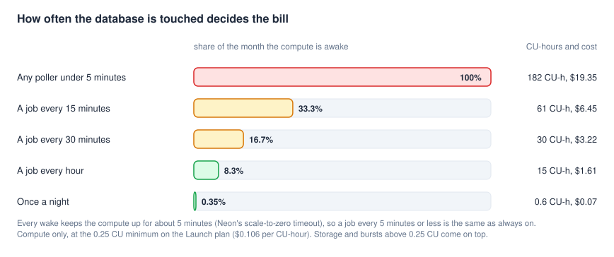
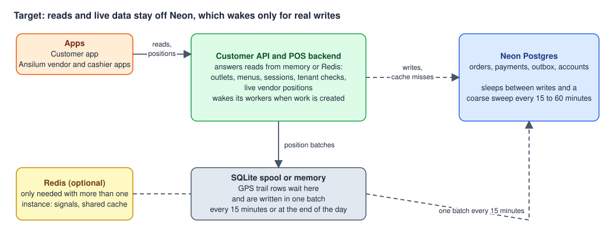

# Strategy: bring the Neon bill close to zero

Written November 2026 for both backends: this customer API (`streetfood-customer-api`, Go) and the POS
backend (`../ansilum-be`, NestJS and Prisma). It answers which one costs more on Neon, why, and what to
change, with SQLite and Redis where they help and where they would do harm.

Everything below comes from reading the code of both projects and from Neon's published documentation.
**I had no access to the Neon console**, so every number about your real bill is an estimate until section 9
(measuring) is done. Section 1 says how sure each statement is.

## Status

**Phases 1 and 2 of the customer API are done**, and Redis pub/sub is integrated for several instances
(November 2026). The POS backend (`ansilum-be`) is done except WP6 to WP8; see [`NEON_PLAN_POS_BACKEND.md`](NEON_PLAN_POS_BACKEND.md) for what changed and what was left out.
Measured against the same Postgres 15, with the real service running:

| | Before | After |
|---|---|---|
| Database transactions per minute, nobody using the app | 273 (about 4.5 a second) | none from the app; the 5 a minute left are Postgres's own background work |
| Customer with the app open (`nearby`, `menu`, `outlet`, `/v1/me`) | one or more statements per request | **0**: 60 such requests over a minute sent 2 statements in total, the snapshot's first load |
| A signed-in request | a transaction and an advisory lock to look the account up, plus a connection ping | the account is remembered for 5 minutes: no statement. `GET /v1/me` is answered from it |
| Extra round trip per request on a quiet service (pgx pings a connection idle for a second) | yes | no: ping only after 3 idle minutes (pgx 5.13 `ShouldPing`) |
| Connection held for `LISTEN` | yes, reconnecting after every suspend | none |
| A commit that creates work reaches its worker | within 1 to 2 s (the poll) | 30 ms |
| A retry or deadline | at the next poll | at its due time (a row due in 3 s was claimed at 3.08 s) |
| Another instance's write reaches this instance | never (no `LISTEN` through the pooler), or by the 15 s re-read | 0.1 s with Redis (a name change made on instance A showed on B at once) |
| Neon can suspend | no | yes, after 5 idle minutes |

What changed in this repository:

- **Phase 1.** `internal/controller/poller`: workers do not poll; they run when woken, when the next
  scheduled item falls due (`persistent/due.go`), and on a sweep (`WORKER_SWEEP_INTERVAL`, 1 hour).
  `pkg/postgres/commits.go` (`CommitTracer`) hears this process's own commits, wakes every worker after a
  commit that wrote rows, and delivers committed `pg_notify` calls to the order streams. `LISTEN` is gone.
  Order streams re-read only when woken and once every 2 minutes.
- **Phase 2.** `internal/usecase/discovery/cache.go` answers `nearby`, `outlet`, `menu` and ratings from a
  snapshot that reloads when a watched table is written (at most every 5 seconds, at least every 10
  minutes). `internal/usecase/identity` remembers an account for 5 minutes and forgets it when it changes.
  `GET /v1/me` uses the account the sign-in check already loaded.
- **Redis.** `pkg/signals` publishes this instance's commits, order changes and account changes, and delivers
  the other instances' (README, "Redis"). It stores nothing and is optional; a Redis that is down only delays
  the other instances to their sweep.
- **Settings.** `WORKER_SWEEP_INTERVAL` (1 hour), `INTEGRATION_RECONCILE_INTERVAL` (1 hour), `REDIS_URL`
  (empty). `INTEGRATION_WORKER_INTERVAL` is removed. Connections are named (`application_name`), keep no
  minimum, and close after 4 idle minutes.
- `pgx` was upgraded from 5.7.4 to 5.13.0 for `ShouldPing`.

Still reading Postgres on each request (real use, not polling): orders and their lists, checkout, payments,
reviews, devices. Not done: the POS backend, and vendor positions off Postgres (Phase 3 in section 5).

---

## Contents

1. [The short answer](#1-the-short-answer)
2. [How Neon bills, and the one rule that matters](#2-how-neon-bills-and-the-one-rule-that-matters)
3. [Where the compute goes today](#3-where-the-compute-goes-today)
4. [The strategy](#4-the-strategy)
5. [The plan, in phases](#5-the-plan-in-phases)
6. [Where Redis and SQLite fit, and where they must not](#6-where-redis-and-sqlite-fit-and-where-they-must-not)
7. [Changes per project](#7-changes-per-project)
8. [What "almost nothing" costs](#8-what-almost-nothing-costs)
9. [Measuring, before and after](#9-measuring-before-and-after)
10. [Rules we keep, and the risks](#10-rules-we-keep-and-the-risks)
11. [Decisions needed](#11-decisions-needed)
12. [Corrections to earlier advice](#12-corrections-to-earlier-advice)
13. [Alternative considered: pivot to Kafka](#13-alternative-considered-pivot-to-kafka)
14. [Sources](#14-sources)

---

## 1. The short answer

**Which project uses more Neon compute?**

| | Customer API (this repository) | POS backend (`ansilum-be`) |
|---|---|---|
| Idle load, nobody using the apps | **High and unconditional.** Seven background loops query the database all day and night, about 2.8 statements per second (about 240 000 a day), plus a connection held open for `LISTEN` | **Low** after its own audit of 25 and 26 October: one email check and the nightly jobs. But two things added since then raise it (see below) |
| Load while people use the apps | Customers browsing the map, and every open order screen, read the database every 15 seconds | **Higher per request**: analytics and sales queries, and every open POS device calls the server every 15 seconds, which reads the database |
| Can Neon ever suspend? | **No.** Not while the loops run | **Yes at night**, not during business hours |
| Confidence | High: the loops are in `internal/app/app.go` and cannot be switched off | Medium: depends on which worker flags are on in your environments |

So, **for idle compute the customer API is the bigger consumer, by design**. For the work done on real
requests the POS backend is heavier. If both talk to the same Neon project the bills add up, and
**tagging each service's connections (section 9) is the first thing to do** to see the real split.

Two findings in the POS backend that you may not expect:

1. Since the audit, new background jobs were added that run every 5 and 15 minutes
   (`reservation.cron.ts` `*/5`, `trust.cron.ts` `*/15`, and an hourly `:15`). The audit
   (`docs/performance/DATABASE_PERFORMANCE_AUDIT.md`) says every periodic job was moved to once a night.
   A job every 5 minutes keeps the compute on around the clock (section 2). The files were last
   changed in commits of 1 and 2 November, after the audit; check `git log` to confirm which change
   introduced them.
2. The StreetFood features need `STREETFOOD_WORKERS_ENABLED=true`, which starts a worker that wakes every
   5 seconds, and a change scan every 15 seconds that rebuilds each published outlet's catalog. The food
   delivery worker, when enabled, wakes every second. With these on, the POS backend has a constant floor
   again.

**Can the bill go to "almost nothing"?** Yes for the idle floor, and close to it for real use, if the work
is changed from polling to waking on events, reads are served from memory, and fast-changing data (vendor
positions) stays out of Postgres. Redis and SQLite are tools for part of that, not a replacement for the
database. Section 8 gives the numbers: from about **$19 a month per always-on database** to **a few
dollars or less**, and inside Neon's free allowance for a quiet staging environment.

---

## 2. How Neon bills, and the one rule that matters

Neon bills compute by **CU-hours**: how many compute units the database used, for how long it was awake. A
compute **suspends after 5 minutes without queries** and wakes in a few hundred milliseconds on the next
connection ([Neon, scale to zero](https://neon.com/docs/introduction/scale-to-zero)). While suspended, compute
costs nothing. Storage is billed separately.

| Plan (November 2026) | Compute | Storage | Scale to zero |
|---|---|---|---|
| Free | 100 CU-hours per project per month included, up to 100 projects | 1 GB per project | fixed at 5 minutes |
| Launch | $0.106 per CU-hour, no monthly minimum | $0.35 per GB-month | on, or you can turn it off |
| Scale | $0.222 per CU-hour | $0.35 per GB-month | configurable from 1 minute |

(Figures from [Neon's pricing announcement](https://neon.com/blog/new-usage-based-pricing); check the pricing
page before you decide anything.)

**The rule.** Every time something touches the database, the compute stays up for about 5 more minutes.
Therefore:

- A job or request that runs **every 5 minutes or less is the same as keeping the database on 24/7**.
- A job that runs every 15 minutes keeps it on a third of the time, every 30 minutes a sixth, every hour
  about 8%.
- **A burst of many queries costs no more than one query.** What costs is the number of separate wake-ups.
  So batch work, and run it rarely.



Always on at the 0.25 CU minimum is 730 hours × 0.25 = **182 CU-hours a month, about $19 on Launch, per
database**. That is more than the whole Free allowance (100 CU-hours), and your staging and production are
likely two databases.

Other facts that matter here:

- An **idle open connection does not keep the compute awake**; only queries do, and a suspend drops the
  connection ([independent test](https://devops-daily.com/posts/what-keeps-a-neon-compute-awake)). But a
  program that **reconnects** right after the drop wakes the compute again. That is what the customer API's
  `LISTEN` loop does (section 3).
- The pooled endpoint (`-pooler`) lowers connection counts, not the bill.
- The first query after a suspend takes a few hundred milliseconds longer. Section 10 covers what that
  means for payment callbacks and the first app request of the morning.

---

## 3. Where the compute goes today

### 3.1 Customer API

Each loop below runs forever (`internal/app/app.go` lines 114 to 121). When there is nothing to do, each
tick is still one claim or select statement.

| Loop | Interval | Statements per second when idle |
|---|---|---|
| POS events (`integ.Process`) | 1 s | 1.00 |
| Order submit (`orders.ProcessSubmits`) | 1 s | 1.00 |
| Push notifications (`notifier.Process`) | 2 s | 0.50 |
| Payment check (`pay.Poll`) | 10 s | 0.10 |
| Refunds (`pay.Refund`) | 10 s | 0.10 |
| Payment expiry (`pay.ExpireUnpaid`) | 15 s | 0.07 |
| Order refresh (`orders.RefreshStale`) | 30 s | 0.03 |
| **Total** | | **about 2.8, or 240 000 a day** |

That is the same pattern that the POS backend audit found and fixed in its email worker (about 260 000
statements a day, "keeps Neon compute busy 24/7").

Also in this service:

| Item | Where | Effect |
|---|---|---|
| `LISTEN order_updates` on a held connection, reconnecting with backoff of 1 to 30 seconds | `persistent/orders.go`, `usecase/ordering/hub.go` | After Neon suspends, the dropped connection is re-established within seconds, which wakes it again. **This alone prevents scale to zero**, even after the loops above are fixed |
| Every signed-in request runs `FindOrCreateCustomer` | `usecase/identity` | One database round trip per request, even though Firebase already proved who the customer is |
| `GET /v1/outlets/nearby` and `/outlets/{id}` always query Postgres (`Cache-Control: no-store`) | `usecase/discovery` | A customer with the map open touches the database every 15 seconds |
| The order stream re-reads the order from the database on every 15-second heartbeat | `controller/http/v1/orders.go` | Each open order screen touches the database every 15 seconds, even when nothing changed |
| Reconciliation of every merchant | every 15 minutes | One wake every 15 minutes: a third of the month on its own |
| `/healthz` | no database | Fine |

### 3.2 POS backend

| Item | Interval | Notes |
|---|---|---|
| Email worker | sleeps until work is due, ceiling at the nightly run | **Already fixed** (audit 25 and 26 October) |
| Nightly jobs (storefront, renewals, trust retention, AI units) | 00:00 Asia/Jakarta | Fine: one wake a day |
| `reservation.cron.ts` `releaseExpiredPromotions` | **every 5 minutes** | Added after the audit. Keeps the database on 24/7 |
| `trust.cron.ts` `expireTrials` | **every 15 minutes** | Added after the audit. One third of the month |
| `reservation.cron.ts` `releaseForgottenTables` | hourly at :15 | About 8% of the month |
| StreetFood worker (`streetfood-worker.service.ts`) | **every 5 s** when `STREETFOOD_WORKERS_ENABLED=true`: expire due orders, close stale days, dispatch outbox; a catalog scan of every published outlet every 15 s | Constant floor while on |
| Food delivery worker | **every 1 s** when `FOOD_DELIVERY_WORKERS_ENABLED=true` | Constant floor while on |
| POS app connectivity probe | every 15 s per open device, to `/auth/pos/sync/capabilities` | Each call reads the session (Better Auth `cookieCache` is off, about 2 statements) and checks whether the fulfillment tables exist. **Every open POS device keeps the database awake for the whole business day** |
| Vendor location pings | one `POST location/pings` per vendor every 15 to 120 s | Each batch inserts rows, updates the live position and the session counters, and may write an outbox event. Real work, but a lot of it |
| Reports and analytics | on demand | The heaviest queries per request. Aggregated in SQL since the audit; billed by CU while they run |

The POS backend's own audit already measured and fixed its idle load once. The lesson of that audit still
applies: **an idle backend should not touch the database; the clients' own polling is "real usage"** and
needs its own fix (section 7).

---

## 4. The strategy

Four principles, in this order. The first two do most of the work and need no new infrastructure.

1. **Never poll the database. Wake workers when work is created.** After a transaction commits, tell the
   worker in-process that there is work. When idle, sleep until the next known due time (a retry, a
   lease, an expiry), looked up once, and run one coarse safety sweep every 15 to 60 minutes. This is the
   pattern the POS email worker already uses, with its `afterCommit()` wake and its "sweep while the
   database is already awake" rule.
2. **Answer reads from memory.** Outlets, menus, sessions, tenant and subscription checks, customer
   accounts and `capabilities` change rarely and are read constantly. Keep them in a process-local cache
   invalidated by the events that change them, with a short TTL as a backstop. A customer opening the map
   then costs no database time.
3. **Keep fast-changing, disposable data out of Postgres.** A vendor's live position is stale after 10
   minutes and only the newest reading matters. It does not need a durable row per reading. Hold it in
   memory (or Redis if there are several instances) and write the trail in batches.
4. **Keep authoritative data in Postgres, written in the same transaction as today.** Orders, payments,
   refunds, the fee ledger, accounts, the outbox rows. Only the *polling* of these goes away, not the
   rows. This is what keeps the guarantees in `HOW_IT_WORKS.md` ("the event exists if and only if the
   change committed").



What is left on Neon is real writes, plus a coarse sweep. A vendor's working day still produces writes
(orders, a session start and end, a batch of position rows now and then), so **during business hours the
database will be awake for part of the time**, and that is the cost of doing business. Section 8 puts a
number on it.

---

## 5. The plan, in phases

| Phase | What | Project | Saves | Effort | Risk |
|---|---|---|---|---|---|
| 0 | Measure: tag connections, read Neon's active time and top statements | both | Tells you where to start | Hours | None |
| 1 | Replace the polling loops with wake-on-commit plus one coarse sweep | customer API | The 240 000 statements a day and the always-on floor | 2 to 4 days | Low: same rows, same claims |
| 1 | Replace `LISTEN` with an in-process signal (and Redis pub/sub only when there are several instances) | customer API | Removes the reconnect that wakes the database | 1 day | Low |
| 1 | Move the new crons (`*/5`, `*/15`, hourly) to the nightly run, or to "sweep while awake" | POS backend | Removes a 5-minute wake-up cycle | Hours | Low, if promotion release and trial expiry can wait for the night or be enforced on read (decision 5) |
| 1 | Use "sweep while awake" for the StreetFood and food delivery workers | POS backend | The 5 s and 1 s floors | 1 to 2 days | Low: copy the email worker's pattern |
| 2 | Cache `Authenticate`'s customer lookup (5 minutes) and serve `nearby` and `menu` from memory | customer API | Customers' browsing no longer wakes Neon | 2 to 3 days | Medium: suspended accounts take up to the TTL to be refused |
| 2 | Order stream: re-read only on a signal, with one slow safety re-read | customer API | One read per open stream every 15 s | Hours | Low |
| 2 | Cache POS sessions, tenant guard and `capabilities`; make the app's probe cheap | POS backend and Flutter | The business-day floor from open devices | 2 to 4 days | Medium: session revocation delay (section 7.2) |
| 3 | Live vendor position in memory; trail rows buffered and written in batches | POS backend, customer API | The recurring writes of a vendor's day | 1 to 2 weeks | Medium: crash loses at most one batch of trail rows |
| 4 | Optional: move the customer API's read model to SQLite | customer API | Neon bill of that service to nothing | Weeks | **High**: a rewrite, and a single-instance limit (section 6.3) |

Phases 0 to 2 are small and keep the architecture. Do them in this order and re-measure after each. Phase 3
is a design change. Phase 4 is a different product decision; section 6.3 explains why it is not recommended
now.

---

## 6. Where Redis and SQLite fit, and where they must not

### 6.1 In-process memory first

You run one container per service (`docker-compose.deploy.yml`, and `docker-compose.production.yml` in the POS
backend). **For one instance, a map in the process is faster, free, and enough** for most of the plan:
wake-ups, the caches, and the live position. Redis solves a different problem: *several instances need to
share state or signals*. Add it when you run more than one instance of a service, not before.

### 6.2 Use of each

| Need | Best store | Why | Must not |
|---|---|---|---|
| Wake a worker after a commit | In-process signal (Go channel, Node `EventEmitter`) | Free; the POS backend already has `afterCommit()` | Replace the outbox row. The row stays in Postgres in the same transaction; the signal is only a doorbell |
| The same wake across several instances | Redis pub/sub or a stream | One command per event, nothing polled | Treat it as durable. A missed message is repaired by the coarse sweep |
| Order-change signals for the order stream | In-process hub now; Redis pub/sub for several instances | Replaces `LISTEN`/`pg_notify` | Keep `LISTEN`: it reconnects and wakes the database |
| Session and rate-limit state of the POS backend | Redis through Better Auth's `secondaryStorage` (version 1.7.10 supports it) or a process-local cache | Removes about 2 statements per request | Cache sessions in a cookie without a decision on revocation (audit item 16) |
| Customer account lookup, tenant and subscription checks, `capabilities` | In-process cache with a TTL of 30 seconds to 5 minutes | Read thousands of times, changed rarely | Cache anything that grants access without a TTL |
| Outlets, menus, nearby search | In-process snapshot, rebuilt as POS events are applied | `nearby` becomes a loop over memory | Keep results across a restart without reloading from Postgres |
| Live vendor position | Memory (one instance) or Redis with a TTL of 10 minutes (several) | Newest reading wins; stale after 10 minutes anyway | Be the only copy of the trail |
| Vendor GPS **trail** rows (for the owner's reports) | **SQLite file on a persistent volume**, flushed to Postgres every 15 minutes and at the end of the day | Survives a restart; no Neon wake per batch | Be shared by two instances, or live on the container's temporary disk |
| Orders, payments, refunds, fee ledger, accounts, outbox | **Postgres only** | Money and legal records; transactional with the outbox | Move to Redis or SQLite |

### 6.3 SQLite for the whole customer API (Phase 4), and why not now

The customer API has its own database and one instance. In principle it could run on SQLite in WAL mode with
Litestream copying it to object storage, which would take its Neon bill to **zero**. It is not
recommended now:

- The code uses Postgres features throughout: `cube` and `earthdistance` for nearby search, GiST indexes,
  `FOR UPDATE SKIP LOCKED` claims, `LISTEN`/`NOTIFY`, `jsonb`, advisory behaviour in migrations.
- SQLite allows one writer and one machine. Several instances, or a rolling deploy with two containers
  running at once, are no longer possible.
- You take over backups and restores that Neon gives you (branches, point-in-time restore).
- Payment and order data would depend on a file on one disk.

The same savings (almost all of the idle bill) are available with Phases 1 and 2 at a fraction of the work.
Revisit SQLite only if, after those, the customer API's database still costs more than you are willing to pay.

### 6.4 Redis hosting

The shared development infrastructure already runs `redis:7`. For staging and production, run one Redis next
to the app on the same host (a container with `appendonly yes` and a memory limit) or use a managed Redis
with a free tier. A managed Redis bills per command or per instance, so keep commands few: one `PUBLISH`
per event and one `GET` per cache miss, not per request. Self-hosted Redis does not appear on the Neon bill
at all.

---

## 7. Changes per project

### 7.1 Customer API

**A. Pollers become wake-ups plus a sweep** (`pkg`/`internal/controller/poller/poller.go`, `internal/app/app.go`).

- Give `Poller` a `Wake()` method (a one-slot channel). Select on it next to the timer.
- Make the idle interval configurable per loop and long: a coarse sweep of 15 to 60 minutes.
- After a claim finds nothing, ask once for the next due time (the smallest `available_at`, lease expiry or
  `expires_at` across that queue) and sleep until then, capped at the sweep interval. This is how the POS
  email worker avoids polling while still retrying on time.
- Call `Wake()` where work is created:
  - after `integration_inbox` rows are stored (`POST /v1/integrations/pos/events`),
  - after a checkout stores an order that must be submitted,
  - after a `notification_outbox` row is added,
  - after a payment is created (to start its 20-second status check) or becomes refundable,
  - when a payment's callback arrives.
- `payment check` and `order refresh` only matter while there are open payments or open orders. Start their
  timers from the event that opens them, and stop when none are open.

**B. Replace `LISTEN`.** The code that does `pg_notify('order_updates', id)` already runs after the change
commits. Call `hub.Notify(id)` in the same place for the local instance. Remove `ListenOrderUpdates` and the
reconnect loop (`hub.Run`). With several instances, publish to Redis and have each instance subscribe.

**C. Reads from memory.**
- `Authenticate`: cache `(firebase uid) -> customer` for 5 minutes. A suspended or deleted account is refused
  within that time, which must be acceptable (decision in section 11).
- `nearby`, `outlet`, `menu`: keep a snapshot of published outlets and their menus in memory, updated by the
  same code that applies POS events (`integration.apply`) and reloaded at start and by the coarse
  reconcile. Search by distance in Go. Keep the 15-second client poll: it now costs nothing.
- `reconcile` every 15 minutes becomes hourly, plus a button or admin call for "reconcile now". The POS
  pushes events, so reconciliation is only a safety net.

**D. Order stream.** Keep the heartbeat `: ping` every 15 seconds, but re-read the order only when the hub
signals a change, and once more every 2 minutes as a safety net while a customer is watching.

**E. Connection settings.** Add `application_name=streetfood-customer-api` to `PG_URL`. Set the pool's
`MaxConnIdleTime` to a few minutes and keep `MinConns` at 0 so nothing holds or revives a connection while
idle. Keep `PG_URL` on the pooled endpoint **only after `LISTEN` is gone** (section 12).

### 7.2 POS backend

**A. Crons.** Move `releaseExpiredPromotions` (`*/5`), `expireTrials` (`*/15`) and `releaseForgottenTables`
(hourly) to the nightly schedule, or have them run only when another statement just ran, using the same
`shouldSweepWhileAwake` rule as the email worker. If a promotion must be released on time, release it **on
read** (when the order or promotion is next loaded), as the storefront and payment-order expiry already do.

**B. Workers.** Apply the email worker's pattern to `StreetfoodWorker.tick` and `DeliveryWorker.tick`:
wake after commit (`afterCommit()`), sleep until the next due time, sweep while the database is already awake,
and run the full scan nightly plus when a publisher changes a menu or outlet. The change scan can be driven
from the services that edit outlets, menus and hours (a call in the same place that writes the outbox), with
the 15-second fingerprint scan reduced to a slow safety net.

**C. Sessions and tenant checks.** Turn on Better Auth `secondaryStorage` with Redis (or a process-local
cache for one instance) so session reads stop reaching Postgres, and cache `TenantGuard`'s membership and
subscription lookups for 30 to 60 seconds, invalidated on subscription events. Session revocation then
takes effect immediately with Redis (it is deleted from Redis), or within the TTL with a process-local cache.
This answers audit item 16 without the cookie-cache trade-off.

**D. `capabilities`.** Cache `fulfillment.available()` for the life of the process once it is true. With the
session cached, the app's 15-second probe no longer reaches Neon. In the Flutter app, probe a
database-free route (for example `/app/terrapos/health`) every 15 seconds and call `capabilities` only at
start, on resume and after a failed sync.

**E. Vendor pings (Phase 3).** `ingestPings` writes to Postgres for every batch. Split it:
- judge each reading as today, keep the **current position and distance counters in memory** (Redis for
  several instances), and send `outlet.location.updated` to the customer API directly (it is already
  defined as "only the newest is kept", never queued, so it does not need an outbox row);
- append the accepted readings to a **SQLite file** on a persistent volume, and flush them to
  `outlet_location_pings` every 15 minutes, at `session/end`, and on shutdown;
- keep the session start and end, sharing changes and relocations as transactional writes in Postgres
  (they are rare and they are part of the audit trail).
- What is lost on a crash is at most one flush interval of trail rows for the owner's route report, never
  money and never the working day itself. If that is not acceptable, flush every 5 minutes: the bill grows
  but stays well under always on.

**F. Connection settings.** Add `?application_name=ansilum-be` to the Prisma URL (Prisma passes it to
Postgres; check that it shows in `pg_stat_activity`), and set `connection_limit` explicitly (the audit
item 12).

---

## 8. What "almost nothing" costs

Compute only, 0.25 CU minimum, Launch plan at $0.106 per CU-hour. Real use adds bursts above 0.25 CU, and
storage adds $0.35 per GB-month (1 GB per project is free on the Free plan). These are estimates for planning,
not a quote.

| Scenario | Active hours a month | CU-hours | Compute cost |
|---|---|---|---|
| Today: customer API always on | 730 | 182 | **about $19** |
| Today: POS backend with the new crons and workers on | 730 | 182 | about $19, more with bursts |
| After Phase 1 only, still a wake every 15 minutes (reconcile, crons) | about 240 | 61 | about $6.50 |
| After Phases 1 and 2, only real writes during a 10-hour business day, awake all of those hours | 300 | 75 | about $8 |
| After Phases 1 and 2, light real use (an order every 10 to 20 minutes during business hours) | about 150 to 200 | 38 to 50 | about $4 to $5 |
| After Phase 3, business-day writes batched every 15 minutes, plus orders | about 100 to 150 | 25 to 38 | about $2.50 to $4 |
| A quiet staging environment (a few wakes a day) | under 10 | under 3 | **$0, inside the Free allowance** |

How to read this:

- **Idle cost goes to nothing** after Phase 1 and the cron changes: nights, weekends, and any day without
  traffic cost only the nightly wake.
- **The business day sets the floor.** If someone uses the apps all day, the database is awake for those hours
  whatever you do, because each interaction that writes something wakes it for 5 minutes. A realistic target
  for a small operation is **$3 to $8 a month per database** instead of $19.
- Staging fits in the **Free plan** if it follows the same rules: 100 CU-hours a month is about 400 active
  hours at 0.25 CU. Put each environment in its **own Neon project**, so each has its own allowance and
  its own bill line, and so you can see them separately.
- The Free plan is for development and light use. For production, stay on Launch (pay per use, no monthly
  minimum), so a busy month does not suspend the database.
- **Scale plan:** it lets you shorten the suspend timeout to as little as 1 minute, which would cut the cost
  of each wake from 5 minutes to 1. At $0.222 per CU-hour it only pays off if wake-ups are many and short.
  Not needed for this plan.

---

## 9. Measuring, before and after

**Step 1: tag each service.** Add `application_name` to each connection string:

```
postgres://…/streetfood?sslmode=require&application_name=streetfood-customer-api
postgresql://…/ansilum?sslmode=require&application_name=ansilum-be
```

**Step 2: read what Neon says.** In the Neon console, for each project: **Monitoring**, then "compute active
time" and "CU over time" for the last 7 days. Active time near 100% with a flat CU line confirms the
always-on pattern; a stepped line shows suspends. Write the numbers down before changing anything.

**Step 3: find the callers.** In the Neon SQL editor of each database:

```sql
-- the statements that run most often since the compute last started
SELECT calls,
       round(total_exec_time::numeric / 1000, 1) AS total_seconds,
       left(regexp_replace(query, '\s+', ' ', 'g'), 110) AS query
FROM pg_stat_statements
ORDER BY calls DESC
LIMIT 20;

-- who is connected, and what they are doing
SELECT application_name, state, count(*)
FROM pg_stat_activity
WHERE datname = current_database()
GROUP BY 1, 2
ORDER BY 3 DESC;
```

Expect the top rows of the customer API to be the claim queries on `integration_inbox`, `merchant_orders`,
`notification_outbox` and `payments`. Expect the POS backend to show session and tenant lookups from the
probe, plus whichever worker flags are on. (`pg_stat_statements` is reset when the compute restarts, so
read it after a few hours of uptime.)

**Step 4: set targets and re-measure after each phase.**

| Check | Target |
|---|---|
| Statements per minute with no one using the apps | Under 5 per service, and none in most minutes |
| Compute active time at night | Near 0%, apart from the nightly job |
| Compute active time on a day without orders, with the apps open | Only the writes that someone made |
| Longest awake streak at night | Under 10 minutes |
| Monthly CU-hours | Under your table in section 8 |

---

## 10. Rules we keep, and the risks

**Rules (they come from the existing design and must survive this work):**

1. The event, the order, the payment and the outbox row are written in the **same Postgres transaction**.
   Redis and SQLite never become the only copy of anything that moves money or must be audited.
2. A signal is a hint. Every signal has a sweep behind it, so a missed wake only delays work.
3. Every cache has a TTL and an invalidation. Nothing that grants access is cached for longer than the
   delay you have accepted (section 11).
4. Positions: newest reading wins, and a position older than the last "cleared" never returns (as now).

**Risks and how they are handled:**

| Risk | Handling |
|---|---|
| **Cold start**: the first query after a suspend takes a few hundred milliseconds more. A payment callback or the first request of the day pays it | Set connection and request timeouts above 3 seconds, make gateway callbacks idempotent (they already are), and let pools reconnect (pgx and Prisma do) |
| A worker sleeps too long and a retry is late | "Sleep until the next due time" is computed from the data; the coarse sweep is the backstop; unit-test it as the email worker's `email-schedule.ts` is |
| A crash loses buffered trail rows (Phase 3) | At most one flush interval of GPS trail; positions, orders and money are unaffected. Flush on shutdown and at day end |
| Cached sessions or accounts outlive a suspension or revocation | Redis `secondaryStorage` deletes on revoke; a process-local cache is bounded by its TTL. Decide the TTL (section 11) |
| Two instances behind the wake-up mechanism | Wake-ups stay local; the coarse sweep catches work created on the other instance. Add Redis pub/sub at that point |
| Moving jobs to the night delays user-visible expiry | Enforce expiry **on read** (as the POS already does for storefront and payment orders) and let the night job only record it |
| Neon Free plan limit reached | The Free plan's 100 CU-hours are a hard allowance (check Neon's current behaviour when it runs out). Keep production on Launch, which bills per use |

---

## 11. Decisions needed

1. **Are the two services on the same Neon project or plan?** It decides whether the bills add up and where
   the free allowance applies. Recommended: one project per service per environment.
2. **How long may a suspended customer account stay usable?** 5 minutes is proposed (the cache TTL in 7.1C).
3. **How long may a revoked POS session stay usable?** Zero with Redis `secondaryStorage`; the cache TTL
   without it (audit item 16).
4. **Is a cold start of a few hundred milliseconds on the first request of the day acceptable?** It is
   the price of paying nothing at night.
5. **Can promotion release and trial expiry wait for the nightly run (or happen on read)?** If one of them
   must be timely, name the maximum delay.
6. **How much GPS trail may be lost in a crash?** 15 minutes is proposed; 5 minutes costs a little more.
7. **Where will Redis run, if at all?** Not needed for one instance per service; section 6.4 gives the options.
8. **Do you want Phase 3 (positions out of Postgres)?** It is the largest change; do Phases 0 to 2 first and
   measure what a working day still costs.

---

## 12. Corrections to earlier advice

- **`PG_URL` on the pooled endpoint.** The deployment guide in `README.md` tells you to use Neon's pooled
  (`-pooler`) string for the customer API. The API used `LISTEN`/`NOTIFY` for the order stream, which does not
  reliably deliver through the pooler's transaction mode. **Resolved:** `LISTEN` is gone (see Status), so the
  pooled endpoint is correct.
- **A wake-up loop around `LISTEN`.** The reconnect after a suspend woke the database again (section 3.1).
  **Resolved** by the same change.
- **"Keep a single instance until you have checked the workers"** in the deployment guide: with the changes
  above, one instance per service is also what keeps the design simple and Redis optional.

---

## 13. Alternative considered: pivot to Kafka

Question: move both backends to Kafka event streaming on a managed free tier, add Redis for caching, and
keep Neon only for real records. The goal (Neon holds records, not event transport) is the same as this plan's.
The Kafka route is **not recommended**, for these reasons.

**1. It does not remove the hard part, the dual write.** A record in Postgres and its event in Kafka cannot be
committed together. There are three ways to bridge them:

| Bridge | What happens on Neon |
|---|---|
| Transactional outbox, then a relay that publishes to Kafka | The outbox row stays in Postgres. If the relay polls, you have today's polling again. If it is woken in-process after commit, that is **exactly Phase 1 of this plan**, and Kafka adds nothing on the Neon side |
| Change data capture (Debezium or logical replication) | Neon states that [a connected logical replication subscriber keeps the compute active](https://neon.com/docs/guides/logical-replication-neon): it never scales to zero. This is **worse than the polling it replaces** |
| Publish to Kafka first, write Postgres in a consumer (Kafka as the source of truth) | A different architecture: the HTTP answer comes before the record exists, orders and payments depend on the log, and the checkout flow (which needs the POS price synchronously) has to be redesigned. The free tiers below cannot hold a source of truth |

**2. Consumers that write still wake Neon.** Kafka stops the *polling*, not the *writes*. The saving on Neon
is the same as with in-process wake-ups, which cost nothing to run.

**3. The free managed tiers are not for production data.** What I could confirm in November 2026:

| Service | Reality |
|---|---|
| Aiven free Kafka | The only free managed Kafka I found that is not a trial. Limits ([Aiven](https://aiven.io/free-kafka)): 5 topics with 2 partitions, 250 KB/s in and out, **3 days retention**, one service per organisation, no support or SLA, "built for development and prototyping". **When idle it shuts down automatically and the topic data is lost.** Paid plans start around $35 a month, more than the $19 compute bill this work is meant to cut |
| Confluent Cloud | A [$400 credit for about 30 days](https://support.confluent.io/hc/en-us/articles/47525216842644-Why-was-I-charged-for-a-free-trial), not free forever |
| Upstash Kafka | [Discontinued on 11 March 2025](https://community.fly.io/t/deprecation-notice-for-upstash-kafka/21775) |
| Self-hosted Kafka | Free to license, not to run: a JVM broker (about 1 GB of RAM or more), upgrades, disk, monitoring, consumer lag and dead-letter handling, on one more server |

A free tier that loses data when idle and expires events after 3 days would carry your orders, refunds and
position events with no guarantee. Events that must survive (orders, payments, refunds, fee settlement)
cannot rely on it.

**4. It does not fit the size of the problem.** Orders and status changes are a handful per minute across all
merchants, and positions are one batch per vendor every 15 to 120 seconds. One broker, partitions, consumer
groups, a schema registry and per-topic access rules are built for thousands of messages a second and many
independent consumers. Here there are two producers and two consumers, one instance each.

**5. It couples the two backends more tightly.** Today the customer API and the POS exchange signed HTTP
messages with a key per merchant, idempotency, and 24-hour retries, with no shared infrastructure. A shared
broker adds a shared failure domain and a second contract to keep in sync.

**What to do instead, for the same goal.** Keep the split you described, with lighter tools:

| Kind of data | Store |
|---|---|
| Real records: orders, payments, refunds, fee ledger, accounts, the outbox row of each real event | **Neon**, written in the same transaction |
| Wake-ups, cache invalidation, order-stream signals | In-process now; **Redis pub/sub** when there is more than one instance |
| Live vendor positions and other data that is stale in minutes | Memory, or **Redis** with a TTL |
| Reads: outlets, menus, sessions, tenant checks | **Redis** or in-process cache |
| Work that is not a record (push notifications, position fan-out) | Optional **Redis Streams** (blocking reads, consumer groups, no polling), with the sweep as backstop |

Self-hosted Redis on the same host costs nothing on the Neon bill and gives the streaming-style behaviour
(blocking reads, fan-out) that Kafka would, for the parts of this system that are not records.

**When to revisit Kafka.** Reconsider it when one of these is true, and then on a paid or self-run cluster:

- three or more independent consumers need the same event stream (analytics, search, billing, notifications);
- sustained event rates in the tens per second, or position traffic from thousands of vendors;
- you need to replay history into a new service;
- you run many instances and want strict per-key ordering across them.

None applies now. If it does later, the outbox table from this plan is already the right integration point:
a relay publishes rows to Kafka, and nothing else in the services changes.

---

## 14. Sources

- Neon, [Scale to Zero](https://neon.com/docs/introduction/scale-to-zero): compute suspends after 5 minutes
  without activity; fixed on Free, configurable on Scale.
- Neon, [Compute lifecycle](https://neon.com/docs/introduction/compute-lifecycle): no active queries for 5
  minutes puts the compute in an idle state.
- Neon, [New usage-based pricing](https://neon.com/blog/new-usage-based-pricing): Free 100 CU-hours per
  project, Launch $0.106 and Scale $0.222 per CU-hour, storage $0.35 per GB-month.
- [What keeps a Neon compute awake](https://devops-daily.com/posts/what-keeps-a-neon-compute-awake): an
  independent measurement that idle connections do not stop the suspend, and that a suspend drops them.
- Project files: `internal/app/app.go`, `internal/controller/poller/poller.go`,
  `internal/repository/persistent/orders.go`, `internal/usecase/ordering/hub.go`,
  `internal/usecase/identity/identity.go`, `internal/controller/http/v1/orders.go` (this repository);
  `src/domain/streetfood/streetfood-worker.service.ts`, `src/domain/food-delivery/delivery-worker.service.ts`,
  `src/domain/transaction/reservation.cron.ts`, `src/domain/trust/trust.cron.ts`,
  `src/domain/auth/pos/sync/pos-sync.controller.ts`, `src/app/email/email.service.ts`,
  `docs/performance/DATABASE_PERFORMANCE_AUDIT.md` (`ansilum-be`); and
  `lib/src/presentation/connectivity/pos_connectivity_controller.dart` (`ansilum-flutter`).
