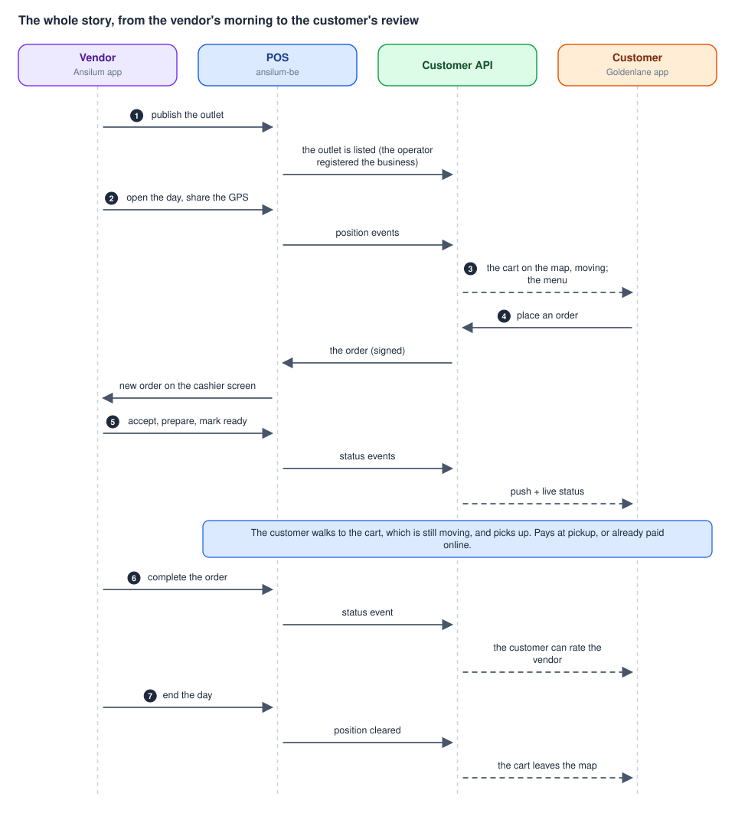
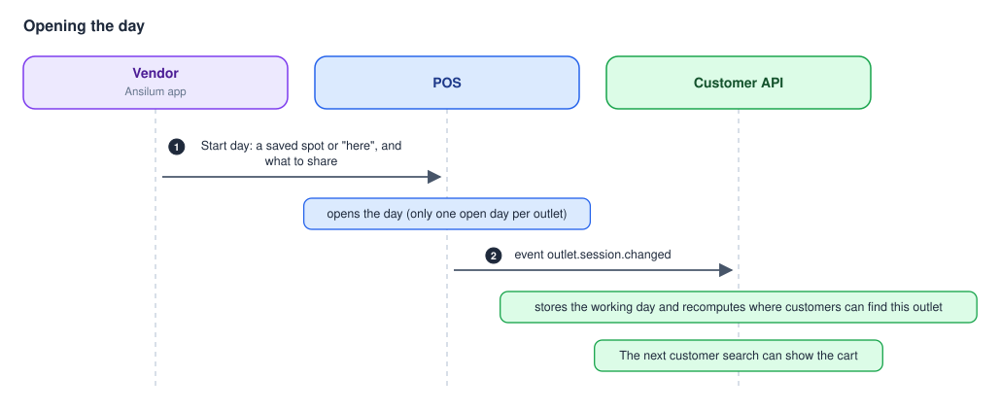
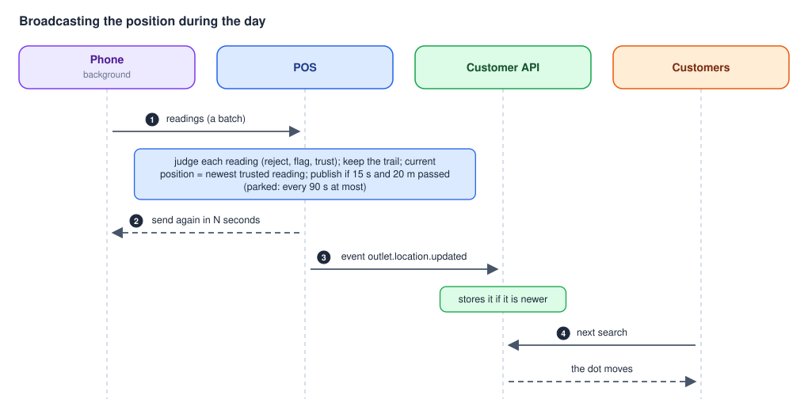
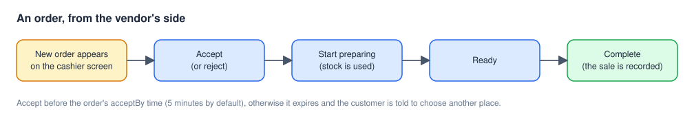
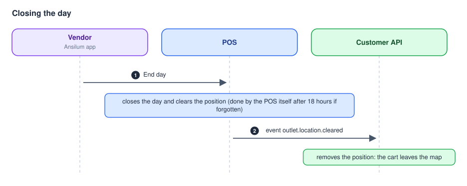
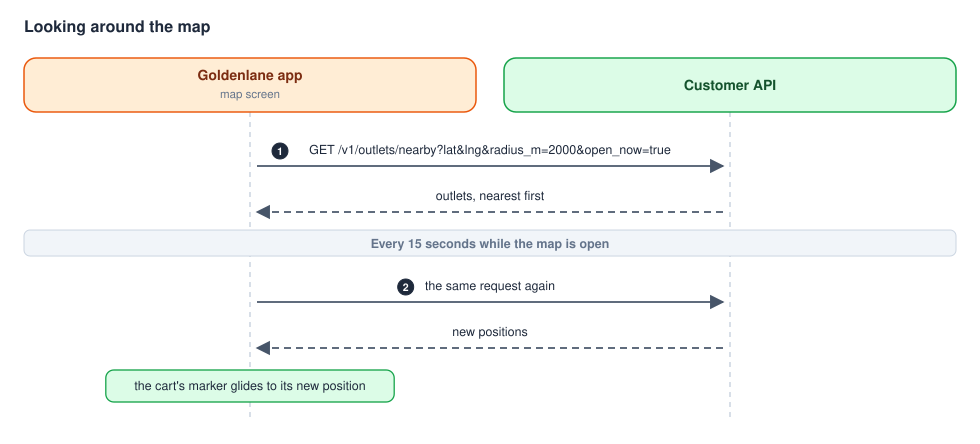
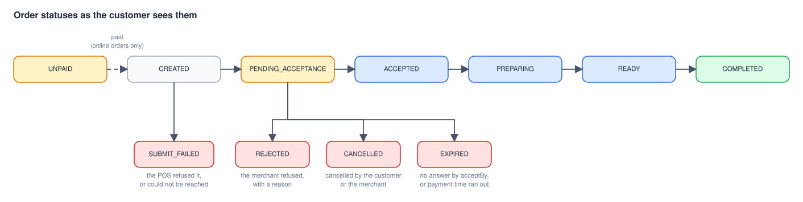

# User journeys: vendors, customers and how they meet

The screen names and button labels below ("Start day", "Accept") describe what each step means; the
actual Ansilum and Goldenlane screens may word them differently.

This document follows each person who uses the system, step by step, and shows what the others see
at the same moment. Read it before [`HOW_IT_WORKS.md`](HOW_IT_WORKS.md) (the technical side) or
[`MOBILE_API.md`](MOBILE_API.md) (the customer and the vendor app APIs side by side).

## Contents

1. [Who is who](#1-who-is-who)
2. [The whole story in one picture](#2-the-whole-story-in-one-picture)
3. [Journey A: a business joins (owner and operator)](#3-journey-a-a-business-joins-owner-and-operator)
4. [Journey B: the vendor's working day](#4-journey-b-the-vendors-working-day)
5. [Journey C: the customer finds a vendor](#5-journey-c-the-customer-finds-a-vendor)
6. [Journey D: an order, paid at pickup](#6-journey-d-an-order-paid-at-pickup)
7. [Journey E: an order, paid online](#7-journey-e-an-order-paid-online)
8. [Journey F: after the meal](#8-journey-f-after-the-meal)
9. [Side by side: what each person sees](#9-side-by-side-what-each-person-sees)
10. [When things go wrong](#10-when-things-go-wrong)
11. [Who can see what (privacy)](#11-who-can-see-what-privacy)
12. [Glossary](#12-glossary)

---

## 1. Who is who

| Actor | Who they are | Their app | Talks to |
|---|---|---|---|
| **Customer** | A person who wants to buy food. | **Goldenlane** (customer app, Flutter) | the customer API (this repository) |
| **Vendor** | The person who sells: pushes a cart, drives a truck, or runs a kiosk. Their phone broadcasts where they are. | **Ansilum** (vendor app) | the POS backend |
| **Cashier / staff** | Whoever takes the order on the merchant's side. At a small cart the vendor is also the cashier. | **Ansilum** (cashier tablet or the same phone) | the POS backend |
| **Business owner** | Owns the business account in Ansilum. Decides which outlets are published and what vendors share. | **Ansilum** (dashboard `dashboard.ansilum.com`) | the POS backend |
| **Operator** | The platform's administrator. Connects a business to the customer app. | an API client (`/v1/admin`) | the customer API |

Two systems sit behind the apps:

| System | Address (staging) | Owns |
|---|---|---|
| **POS backend** (Ansilum) | `https://api.ansilum.com/app/terrapos` | outlets, menus, prices, the vendor's working day and GPS, the merchant's orders and sales |
| **Customer API** (this repo) | `https://staging-goldlane.calterras.com` | customer accounts, customers' orders and payments, push, reviews, the platform's fees |

Two rules explain everything below:

- **The customer app never talks to the POS, and the vendor's phone never talks to the customer API.**
  The two backends keep each other up to date through signed messages.
- **The POS is the source of truth.** The customer API holds a copy of outlets and menus. If the copy
  is wrong, the POS wins and the copy is repaired.

---

## 2. The whole story in one picture

---

## 3. Journey A: a business joins (owner and operator)

This happens once per business, before any customer can see it.

**Actors:** business owner (Ansilum), operator (platform).

| Step | Who | What they do | What happens behind the scenes |
|---|---|---|---|
| A1 | Owner | In Ansilum, links the business to the customer platform, giving the platform's address (`https://staging-goldlane.calterras.com`) | The POS creates a **key id** (`sfk_…`) and a **secret** (`sfs_…`). The secret is shown **once** |
| A2 | Owner | Gives the key id, the secret and the business's tenant id to the operator (securely) | |
| A3 | Operator | Registers the business: `POST /v1/admin/merchants` with the name, tenant id, key id, secret and `posBaseUrl` `https://api.ansilum.com` | The customer API first tests the credentials against the POS. Only if they work are they stored (secret encrypted). Outlets and menus are loaded at once |
| A4 | Owner | For each outlet: sets the status `OPEN` (or weekly hours), and turns **publication** on | The POS announces the outlet; the customer API now lists it |
| A5 | Owner | Chooses the outlet's type: **FIXED** (shop or kiosk at an address) or **MOBILE** (cart or truck) | A fixed outlet is on the map at its address. A mobile one appears only when its day is open (journey B) |
| A6 | Operator (optional) | Connects the merchant's payment account (Xendit or Midtrans): `PUT /v1/admin/merchants/{id}/gateway` | Customers can now choose to pay online at that outlet (`acceptsOnlinePayment: true`). The merchant enters the returned callback URL in the gateway's dashboard |

Result: the outlet exists on both sides. A fixed shop is already visible to customers. A mobile vendor
is still invisible, because it has not opened its day.

If the owner later creates a new secret or reconnects, the operator replaces the credentials with
`PUT /v1/admin/merchants/{id}/link`, otherwise the POS's updates are refused.

---

## 4. Journey B: the vendor's working day

**Actors:** vendor (and owner). Applies to **mobile** outlets. Fixed shops skip the day and the GPS.

### B1. Morning: open the day

The vendor opens the app and starts the working day. Two choices matter:

| Choice | Options |
|---|---|
| **Where** | a **saved spot** ("Depan Stasiun"), or "here" (the phone's position) |
| **What to share** | `LIVE` (customers see the moving dot), `SPOT` (customers see the spot, never the GPS), `HIDDEN` (not on the map) |

Until this moment a mobile vendor is **nowhere** on the customer map. After it, the cart appears at the
spot or at the starting position (and, if `LIVE`, starts to move once readings arrive).

### B2. During the day: broadcasting the position

The vendor's phone sends GPS readings to the POS. The vendor does nothing: it runs in the background.

What the vendor should know:

- **Frequency is automatic.** The POS tells the phone how long to wait: about 15 s while moving and
  60 s while parked when sharing live (30 s and 120 s when sharing only the spot or hiding).
- **Bad readings never move the dot.** Inaccurate (over 100 m), fake ("mock location"), impossibly
  fast, or out-of-order readings are kept for the owner's audit trail but not published.
- **The customer sees the cart a few seconds behind** (at most one update per 15 s, and only after
  moving about 20 m).
- **Offline is fine.** Readings are queued on the phone (accepted up to 24 hours old) and sent when
  the network is back, but only readings newer than the current position move the dot.

### B3. During the day: changing what customers see

| The vendor… | Customers see |
|---|---|
| moves to another place ("relocate") | the new spot or position |
| switches sharing to `SPOT` | a fixed dot at the place of the day; no GPS is published |
| switches sharing to `HIDDEN` | the cart disappears from search (the phone still reports to the POS for the owner's reports only) |
| switches back to `LIVE` | the moving dot returns |
| sets the outlet to closed | the outlet shows `acceptingOrders: false` or `isOpenNow: false` |
| edits the menu or sells out a dish | the menu and the sold-out marks update within seconds to about 15 seconds |

### B4. Taking orders (cashier side)

See journeys D and E for the full order. From the vendor's side, an order is:

The vendor must **accept before the order's `acceptBy` time** (5 minutes by default), otherwise the
order expires and the customer is told to choose another place.

### B5. Evening: close the day

If the vendor forgets, the POS closes the day by itself after 18 hours.

---

## 5. Journey C: the customer finds a vendor

**Actor:** customer, in the Goldenlane app.

### C1. First launch and sign-in

1. The customer opens the app and signs in with their phone number (Firebase sends an SMS code).
2. The app calls `GET /v1/me`. The account is **created on the first call**.
3. The app asks permission for location and notifications, and registers the push token
   (`POST /v1/devices`).

Browsing does not require sign-in; ordering does.

### C2. Looking around the map

For each outlet the customer sees:

| What | Where it comes from |
|---|---|
| name, merchant, address, phone, opening hours | the owner's settings in Ansilum |
| distance from the customer | computed by the customer API |
| **open now**, **accepting orders** | computed from the vendor's working day, weekly hours and the outlet's status |
| position and whether it is **moving** | the vendor's published GPS (`LIVE`), the chosen spot (`SPOT`), or the address (`FIXED`) |
| "last seen" (grey dot) | the position is older than 3 minutes (`stale: true`) |
| rating | the average of customers' reviews |
| "pay in the app" available | the merchant connected a payment account |

What the customer **does not** see: vendors that have not opened their day, vendors sharing nothing
(`HIDDEN`), and vendors whose position is older than 10 minutes.

The customer can also search by text (`q=bakso`) for an outlet, merchant or dish name.

### C3. Choosing

The customer opens an outlet: the detail screen (`GET /v1/outlets/{id}`), the menu
(`GET /v1/outlets/{id}/menu`) and reviews (`GET /v1/outlets/{id}/reviews`). The menu is exactly what the
vendor's POS publishes, with today's availability. Sold-out dishes are greyed out.

---

## 6. Journey D: an order, paid at pickup

The customer pays the vendor in cash or by whatever the vendor accepts at the counter.

### The two sides, step by step

| # | Customer (Goldenlane) | Systems | Vendor / cashier (Ansilum) |
|---|---|---|---|
| D1 | Adds dishes (variants, options, notes), taps **Order** (choosing pay at pickup, pickup or dine-in) | The app creates a fresh `Idempotency-Key` and calls `POST /v1/checkouts` | |
| D2 | Sees "Sending…" | The customer API checks the cart against the stored menu, stores the order (`CREATED`) and sends it to the POS, signed | |
| D3 | | The POS **prices the order** (the only authority on price), checks the outlet is open, stores it as `PENDING_ACCEPTANCE` | A new order appears on the cashier screen (sound, push) |
| D4 | Sees "Waiting for the merchant", the total, and a deadline (`acceptBy`) | The answer comes back in the same request, usually within seconds. The app opens the order stream | |
| D5 | | | The cashier taps **Accept**. They may also reject |
| D6 | **Push**: "Pesanan diterima… (±10 menit)". Status `ACCEPTED` | The POS emits `order.status.changed`; the customer API applies it, queues a push, and wakes the stream | |
| D7 | Sees "Preparing" | | Taps **Start**: stock is consumed. Status `PREPARING` |
| D8 | **Push**: "Pesanan siap diambil". Status `READY` | | Taps **Ready** |
| D9 | Walks to the cart. If it is a moving vendor, the map still shows where it is | | Hands over the food, takes payment |
| D10 | Status `COMPLETED`; can rate the order | | Taps **Complete**: the sale is recorded in the POS's reports (source `STREETFOOD`) |

### Statuses as the customer sees them

### Cancelling

The customer may cancel **until the merchant accepts**. After that, the customer must ask the vendor,
who can cancel from their side.

### Guarantees the customer gets

- **One tap, one order.** A repeated request (bad signal, double tap) returns the same order.
- **The price is the POS's.** If it changed since the customer saw it, the app shows the new total and
  asks again (`PRICE_CHANGED`).
- **Limits** protect vendors from floods: 5 open orders and 20 checkouts per hour per customer.

---

## 7. Journey E: an order, paid online

Used when the outlet shows "pay in the app". The money goes **straight to the merchant's own Xendit or
Midtrans account**; the platform never holds it. The customer pays the order total **plus the platform's
fee** (2.5% by default), shown separately before paying.

| # | Customer | Systems | Vendor / cashier |
|---|---|---|---|
| E1 | Chooses **pay online**, taps Order | The customer API asks the POS for a **quote** (the POS prices it, stores nothing) | Nothing yet: the order is not sent to the vendor until it is paid |
| E2 | Sees the total, the fee and a 15-minute countdown. Order is `UNPAID` | The customer API creates the payment page at the gateway and returns `payUrl` | |
| E3 | Taps **Pay**; the gateway page opens (QRIS, e-wallet, bank transfer) and the customer pays | The gateway tells the API "paid" (a hint). The API **asks the gateway** for the real state before believing it | |
| E4 | Returns to the app. The order moves from `UNPAID` to `CREATED` | The paid order is sent to the POS, marked **prepaid** | The order appears on the cashier screen, already paid |
| E5 | The rest is as in D5 to D10 | | Accept, prepare, ready, complete. No payment to collect |

### If it does not go well

| What happens | Customer sees | What the system does |
|---|---|---|
| The customer closes the payment page | `UNPAID`, **Try again** (`POST /v1/orders/{id}/payment`) until the deadline | Opens a new payment attempt |
| The customer does not pay in 15 minutes | `EXPIRED`, "payment time ran out" | Closes the payment page |
| The customer pays but the vendor rejects, cancels or never answers | "Refund on its way", then "Refunded" | **Automatic refund** to the customer |
| A payment method cannot be refunded by API (for example some bank transfers) | "The merchant will return the money by hand" | The payment is marked, and the merchant refunds manually |
| The gateway's notification never arrives | The status updates anyway, a little later | The API checks open payments itself, about every 20 seconds |

---

## 8. Journey F: after the meal

### The customer

- Rates the order (1 to 5 stars and an optional comment), **once**, only after `COMPLETED`.
- The outlet's average rating updates for everyone.
- Can see past orders (`GET /v1/orders`), and can delete the account (`DELETE /v1/me`), which erases
  their personal data.

### The merchant (money)

- The sale is in the POS reports like any other.
- The platform records its **fee** for each completed order: 2.5% from the merchant on every order,
  and for online orders 2.5% more that the customer paid.
- Fees are collected automatically with the merchant's **monthly subscription charge** (the POS adds
  them to the renewal). The owner can see what is owed in Ansilum. Merchants without an automatic
  renewal are invoiced by the operator.

---

## 9. Side by side: what each person sees

A single order, minute by minute, for a mobile vendor sharing `LIVE`:

| Time | Vendor's phone | Customer's phone |
|---|---|---|
| 08:00 | Day started at "Depan Stasiun", sharing `LIVE` | (not on the map yet if searched before this moment) |
| 08:01 | Cart appears at the spot | Marker appears within seconds (next 15 s poll) |
| 08:10 | Pushing the cart down the street | Marker glides along, `moving: true`, updated every ~15 s |
| 08:12 | | Customer taps **Order** (2 bakso, no celery) |
| 08:12 | New order on the screen | "Waiting for the merchant" |
| 08:13 | Accepts: "10 minutes" | Push: "Pesanan diterima (±10 menit)" |
| 08:14 | Starts preparing | "Preparing" |
| 08:20 | Taps ready | Push: "Pesanan siap diambil". Marker shows where the cart is now |
| 08:22 | Hands over, takes cash, completes | "Completed". Rating prompt |
| 12:00 | Phone loses signal in a tunnel | Marker greys out after 3 minutes ("last seen"), vanishes after 10 |
| 12:07 | Signal back, queued readings sent | Marker returns at the newest position |
| 17:00 | Ends the day | The cart leaves the map |

Rough delays to expect:

| Event | Delay until the other side sees it |
|---|---|
| Vendor moves | up to about 15 s (publish throttle) plus the customer's poll (15 s) |
| Vendor edits the menu or sells out | seconds to about 15 s |
| Customer places an order | the cashier sees it within seconds |
| Cashier changes the order status | the customer's stream updates within a second or two; push shortly after |
| Vendor ends the day | the next customer search no longer lists the cart |

---

## 10. When things go wrong

| Situation | Vendor experience | Customer experience | How it resolves |
|---|---|---|---|
| Vendor's phone is offline | Nothing visible | Dot freezes, "last seen" after 3 min, gone after 10 | Queued readings are sent on reconnect (up to 24 h old); only newer ones move the dot |
| Vendor forgets to end the day | Cart stays "open" | Cart stays on the map | The POS closes the day after 18 hours |
| Vendor wants privacy for a while | Switches to `HIDDEN` | Cart disappears from search | Switch back to `LIVE` |
| The merchant does not answer an order | Missed it | After `acceptBy` (5 min): `EXPIRED`, "try again or pick another place" | Customer orders again elsewhere; online payment is refunded |
| Vendor rejects an order | Taps reject, with a reason | Push "Pesanan ditolak" plus the reason | Online payment is refunded |
| Customer cancels before accept | Order vanishes from the screen | `CANCELLED` | Online payment is refunded |
| Customer wants to cancel after accept | Can cancel the order in Ansilum if the customer asks | `409 CANNOT_CANCEL`, "ask the merchant" | Only the merchant can cancel |
| The price changed between menu and order | | "Prices changed, new total X" and a confirm button | Customer confirms and orders again |
| The vendor sold out a dish just now | | "Some items cannot be ordered" with the lines highlighted | Customer edits the cart |
| The POS is unreachable | Cannot use Ansilum either | Customers still see outlets (the last known copy). New orders fail after about 2 minutes with `MERCHANT_UNREACHABLE` | Retry later. Reconciliation every 15 minutes repairs the copy |
| The customer API is down | Ansilum works as usual | The app cannot load | The POS keeps events queued and retries for 24 hours; everything catches up when the API is back |
| Customer double taps Order | | One order only | The `Idempotency-Key` returns the same order |
| Online payment is stuck | | `UNPAID` with a retry button | Retry, or the order expires at 15 minutes |

---

## 11. Who can see what (privacy)

| Data | Customer | Vendor / cashier | Owner | Operator |
|---|---|---|---|---|
| Vendor's **live** position | only when the vendor chose `LIVE`, as a delayed dot | their own | their own and their staff's | no |
| Vendor's exact GPS when sharing `SPOT` or `HIDDEN` | **never** | their own | yes, in reports | no |
| Vendor's GPS **trail** and distance travelled | never | their own | yes (kept 90 days) | no |
| Customer's **position** | the customer's own phone only. It is sent only as the search centre and is **not written to the logs** | never | never | never |
| Customer's name and phone | their own | not specified by this API: the order sent to the POS carries the items, notes and pickup label | not specified | no endpoint lists customers |
| Customer's orders | their own | orders placed at their outlet | their business's orders | no |
| Merchant's payment keys and POS secret | never | never | never shown again after creation | stored encrypted, never shown |

---

## 12. Glossary

| Term | Meaning |
|---|---|
| **Outlet** | One selling place: a shop, kiosk, cart or truck |
| **Fixed / mobile outlet** | Fixed: has an address. Mobile: moves, with a working day |
| **Working day (session)** | The period a mobile vendor is out selling. Opened and closed by the vendor |
| **Spot** | A saved place the vendor regularly sells from |
| **Sharing** (`LIVE`, `SPOT`, `HIDDEN`) | What the vendor lets customers see of their position |
| **Stale** | A live position older than 3 minutes. Shown as "last seen" |
| **POS** | Ansilum's backend: the merchant's system of record |
| **Customer API** | The service in this repository, behind the Goldenlane app |
| **Operator** | The platform administrator who registers businesses |
| **Idempotency-Key** | A unique id per checkout attempt, so a retry never creates a second order |
| **Minor units** | Money as an integer in 1/100 rupiah (Rp 5.000 is `500000`) |
| **Gateway** | Xendit or Midtrans, the merchant's own payment account |
| **Platform fee** | 2.5% from the merchant on every order and 2.5% from the customer on online orders (default, configurable) |
